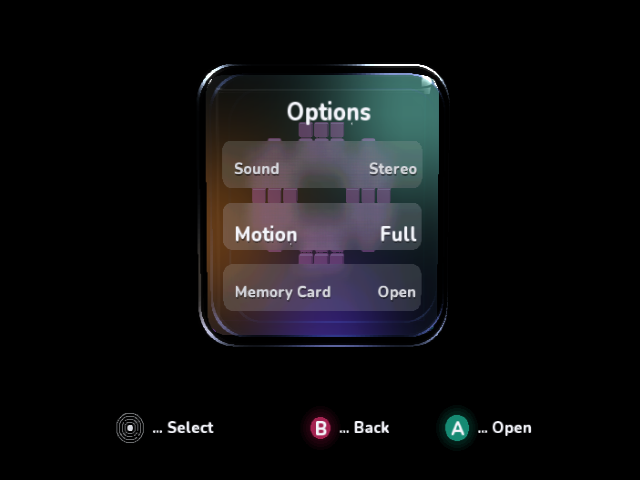
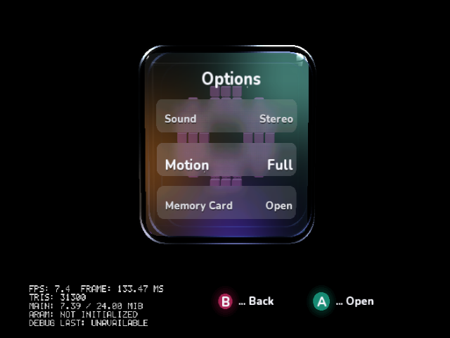

# Antialiasing selection with SDK preview.217.1

The selected default is the bundled, original **IplEdgeAA** single-pass Dolphin
postprocessing shader, with multisampling/supersampling disabled and the full
640×480 EFB retained. It preserves bright text/highlight cores and smooths along
the estimated edge direction. It adds no managed arrays, native meshes or GX
passes to the GameCube DOL; the filter executes in Dolphin's final presentation.

Stronger MSAA/SSAA settings reduced throughput substantially. Hardware AA was
faster but failed final window presentation on this emulator, and built-in FXAA
damaged thin text. Neither was accepted on frame-count evidence alone.

## Measured results

Cloud-local Dolphin 2503, OpenGL 4.5, Mesa 25.0.7 llvmpipe, two raster-worker
threads, a 640×480 X11 window and internal resolution 1×. The same deterministic
native Options scene includes all three 9×9 live-blurred rows and glass reflections.

| Candidate | Active presentations/s | Wall presentations/s | Finding |
| --- | ---: | ---: | --- |
| No AA, paired edge-filter control | 6.58 | 6.16 | Reference, three runs |
| **Selected edge filter** | **6.13** | **5.89** | About 7% active / 4% wall cost; readable text, three runs |
| 4× MSAA | 4.37 | 4.09 | About 30% active cost versus its own control; three runs |
| 4× SSAA | 3.60 | 2.80 | About 42% active cost; one stress run |
| Built-in FXAA | 6.12 | 5.76 | Near baseline, but visibly damages thin text; three runs |
| SDK hardware AA, emulator MSAA off | 7.06 | 6.78 | Faster, but final window is magenta; rejected, three runs |

The MSAA/FXAA/hardware runs have a separate repeated no-AA control of 6.25 active
and 5.66 wall presentations/s. Percentages use each group's paired control, not
an unrelated sample. The selected filter stays within a 10% relative-throughput
cost allowance; stronger viable sample-based settings do not. This is the chosen
tested profile, not a proof of a universal maximum for every GPU.

Active time excludes debugger stop/read intervals. Wall time includes them.
Both are reported because interrupting the guest can perturb scheduling and GPU
overlap. These are **software-emulator throughput numbers**, not physical GameCube
timings or a 60 FPS claim. The diagnostic panel is enabled equally in all benchmark
DOLs and omitted from normal builds. No frame dumping or per-frame breakpoints
run during timing; screenshots are captured afterward.

The driver supports actual 1× and 4× modes. Its requested 2× mode rounds to 4 in
GL capability probes, but Dolphin's supported-mode intersection excludes 2 and
`VideoConfig::VerifyValidity` falls back to **1×**. The initial requested-2× result
therefore measures disabled AA and is excluded. 8× is unsupported, not an accepted
performance candidate.

## Native visual evidence

These are actual native DOL runs. X11 captures include Dolphin's final
postprocessing, unlike raw EFB dumps. The full 640×480 client window is captured
without crop/resize. PPM-to-PNG conversion is lossless.



[Normal interactive native boot](aa-performance/interactive-native.png).



[No AA](aa-performance/no-aa-native.png) ·
[Built-in FXAA, rejected](aa-performance/builtin-fxaa-rejected-native.png) ·
[Hardware AA final window, rejected](aa-performance/hardware-window-rejected-native.png) ·
[Hardware AA raw EFB dump](aa-performance/hardware-efb-native.png).

The hardware-AA EFB contains the scene while a window capture is magenta in an
uninterrupted run. Window positioning/capture interactions have not been isolated
for that case, so the image does not establish an SDK or driver root cause.
Independently, the AA-enabled scan/resolution regression
stalled at frame 255 after keeping 480p AA, before the subsequent 576p preview
produced a frame. [Failure report and retained native stages](scan-modes/sdk-fixed/hardware-aa-experiment/result.json).
Its exact cause has not been isolated between SDK resource/timing behavior and
this emulator. Faster counters and a good EFB dump cannot qualify that setting.
`IplHardwareAntialiasing=true` is therefore restricted to explicit review builds;
normal interactive builds reject that property. The experiment automatically
disables hardware AA for 576 output.
At 480, its 242-line EFB requires a 240-line aligned capture region and adjusted
UVs for the live row blur. Physical hardware remains untested.

## Data and reproduction

- [Paired selected-filter repeats](aa-performance/selected-edge-repeats.json)
- [Windowed MSAA/FXAA/hardware repeats](aa-performance/windowed-repeats.json)
- [Windowed SSAA stress](aa-performance/ssaa-stress.json)
- [Initial headless sweep, including the rejected 2× request](aa-performance/initial-headless-sweep.json)

Build two separate benchmark DOL/ELF pairs with `IplVisualReview=true`,
`IplAntialiasingBenchmark=true` and `IplHardwareAntialiasing=true/false`. Keep them
in `on/VideoMode.dol|elf` and `off/VideoMode.dol|elf` under a binaries directory.
Then run inside the cloud Dolphin image:

```sh
docker run --rm --init --shm-size=1g --volume /workspace:/workspace -e LP_NUM_THREADS=2 \
  dnd-cloud-dolphin xvfb-run -a python3 /workspace/DolphinDotNet.Samples/ci/benchmark_antialiasing.py \
  --binaries /workspace/scratch/aa-benchmark-binaries --logs /workspace/scratch/new-aa-run \
  --warmup 6 --seconds 18 --repeats 3 --candidates off:1:msaa,off:1:edge,off:4:msaa,on:1:msaa
```

The reader samples the SDK's native presentation ring through the GDB stub every
250 ms and validates hardware-AA/EFB readback. It handles Dolphin 2503's repeated
asynchronous stop packets. Candidate order reverses on alternating sweeps.
The GL capability probe prevents silently disabled AA from being counted as a win.

The selected shader is copied to both isolated play/debug profiles by native
builds. Higher-powered GPUs can override sample counts and postprocessing as
described in the sample README. The normal build has no benchmark panel or driver.

Final output alpha is fixed to opaque; EFB alpha must not erase glass passes in
presentation. The final corrected shader was measured again for all three paired
runs above. [Earlier filter prototype data](aa-performance/prototype-edge-repeats.json)
is retained separately. Clean review builds stop after 45 complete native frames
so window captures cannot freeze between the cube and footer passes; benchmarks
explicitly exclude that diagnostic stop.
