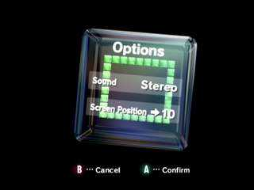
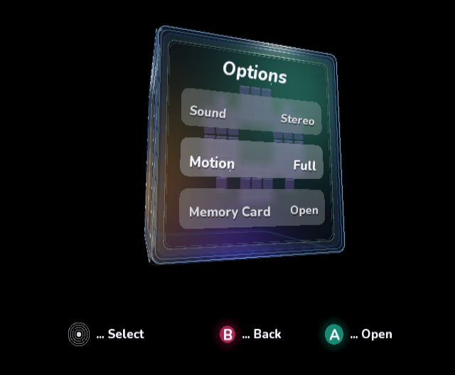
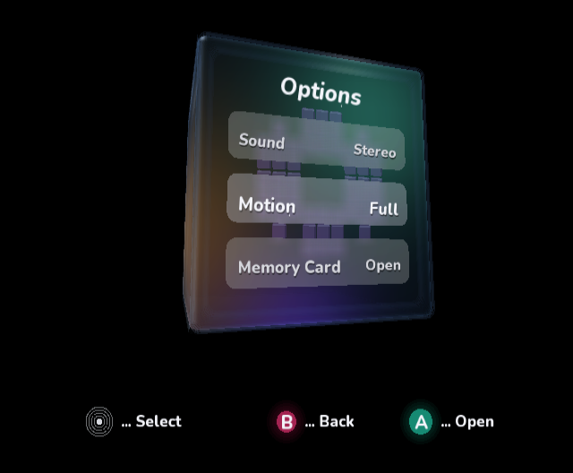
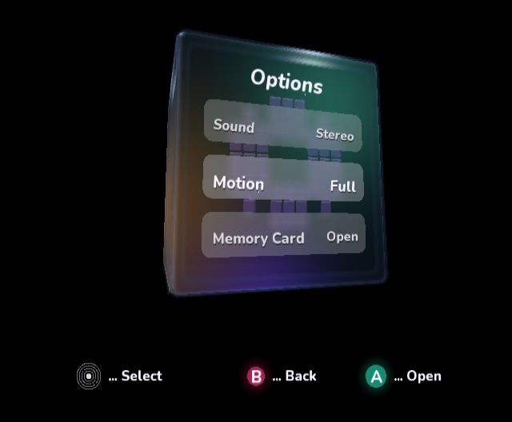
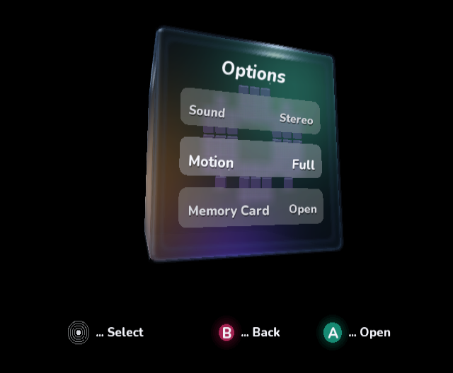
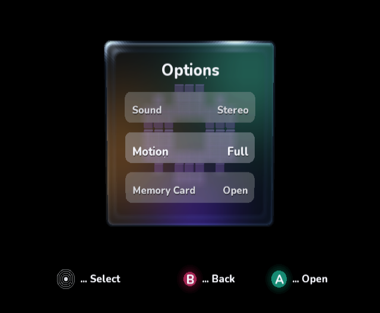
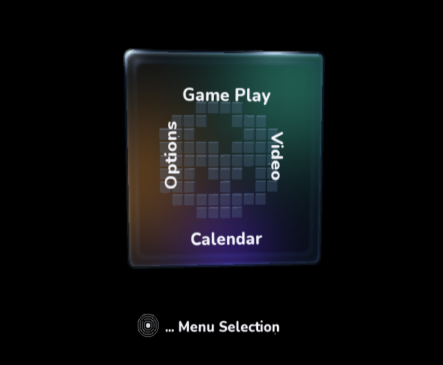

# Angled IPL wall review

This continues native review passes 1–9 in response to the visible hard outlines
at oblique angles. The exact mockup remains the front-facing composition target;
the original IPL is the reference for how glass walls behave while rotated.

## Original reference



Published original IPL screenshot, 320×240, from
[the GameCube IPL reverse-engineering project](https://github.com/chasedykstra/GameCube-Source-Code/blob/master/images/iplmenu.jpg).
The screenshot is retained solely for visual comparison and critical commentary;
Nintendo holds the original interface imagery. It is not used as a texture or
included in the rendered application. The earlier Windows-local user attachments
were not available in the cloud checkout, so this published Options image was used.
No IPL ROM or original renderer source was used.

Its bright reflections occupy localized areas; the straight walls have broad
transmission gradients. Our baseline instead had seven repeated closed strokes
per visible face, which appeared as nested frames at an angle.

## Native comparison

All implementation images below are unmodified GameCube DOL frames from
cloud-local Dolphin/OpenGL under Xvfb. Compare material and geometry rather than
the original screenshot's lower resolution or different row contents. The poses
are similar oblique views, not an exact camera registration.

### Baseline before border removal



### Pass 12: continuous wall cross-section



Removed the seven closed strokes and replaced them with a continuous optical
cross-section. The repeated hard contours are gone, but the wall is too dim and
soft relative to the original.

### Pass 13: localized polish and feathered boundaries



Strengthened localized environment reflections, feathered both ends of the wall
cross-section, and made neighboring rounded corner bands meet continuously.

### Pass 14: curved-surface reflection



Added a grazing-angle reflection term to the actual rounded surface normals.
The left bevel gains a subtle reflection without restoring a closed contour.
The difference from pass 13 is small; the original still has stronger, more
complex glass reflections. The repeated left/bottom outlines visible in the
baseline are absent in the new angled captures.

### Front and normal interactive checks





The 16-band wall cross-section reuses procedural triangles and adds no managed
vertex arrays. Invisible wall faces are skipped. Native frame rate on console
hardware remains unmeasured; this is a visual/native-boot review, not a hardware
performance qualification.

## Validation

All three CI validators, all managed sample builds, all 10 runnable sample test
projects and the two compile-only Kart intrinsic smoke projects passed again.
The angled review builds, final front review build, and normal interactive native
build were each run in Dolphin. The final packaged AOT compiler/artifact verifier
and `git diff --check` also passed. Remote CI status belongs to the current PR head
and is reported separately.

## Reproduction

```sh
dotnet build VideoMode/VideoMode.csproj -c Release \
  -p:DndBuildNative=true -p:DndBuildBackend=Docker \
  -p:IplVisualReview=true -p:IplVisualReviewAngle=true
```

`IplVisualReviewAngle` offsets yaw by 0.30 radians and pitch by −0.16 radians.
It applies only to explicit review builds; normal builds retain interactive
rotation. [Native frame-dump configuration](native-review.md#reproduction).
