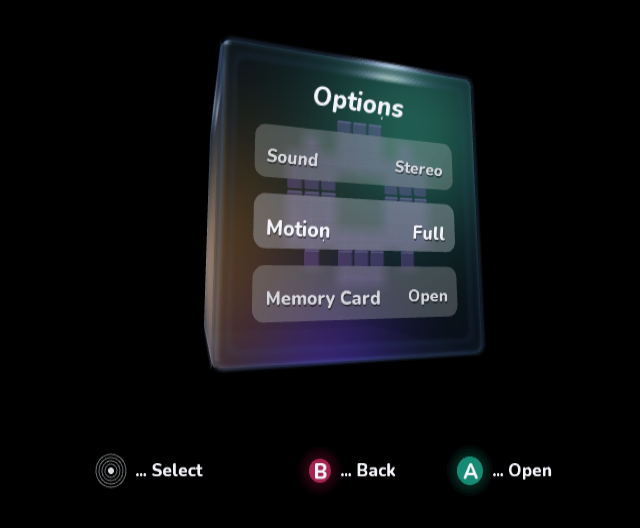

# Dolphin antialiasing review

4× MSAA is now enabled in the sample's isolated Dolphin play/debug profiles by
`DolphinGraphics.targets`. Existing graphics options are retained; only the MSAA
and SSAA keys are replaced. This also updates existing debug profiles.

The following are actual native DOL frame dumps from cloud-local Dolphin/OpenGL,
at the same deterministic angled pose and native internal resolution. No image
resizing, postprocessing or generated imagery was used.

Before (MSAA off):

After (4× MSAA):

The curved silhouette, panel corners and small polygon glyphs are smoother. The
font atlas and face textures retain their existing resolution; MSAA does not
replace them with higher-resolution artwork.

This setting applies to Dolphin. It does not enable GameCube hardware AA in the
DOL: the pinned SDK's public `DisplayOptions` API has no AA switch. Hardware AA
would require a separate SDK/display-mode change and native validation.

For reproducing the native capture procedure from the other review notes, add
`MSAA = 4` and `SSAA = False` to `[Settings]` in the capture profile's `GFX.ini`.

Validation: fresh and existing play/debug profiles, duplicate-key replacement,
preservation of other preferences, idempotence and the opt-out property passed.
The native review build/capture, normal interactive native build/boot, managed
build, existing menu/shell regressions and all three CI validators passed.
