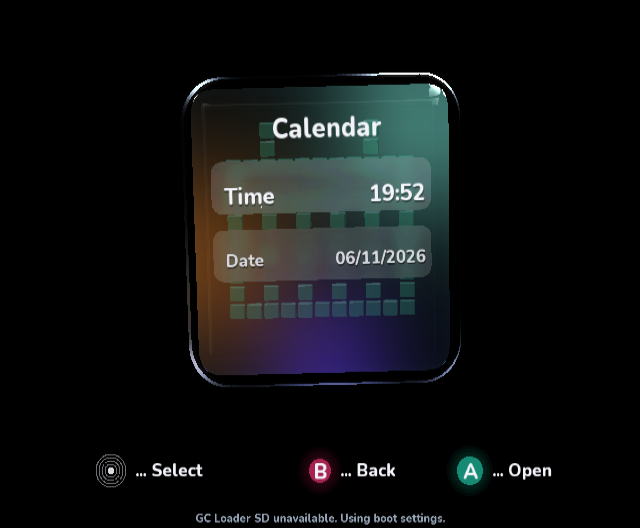
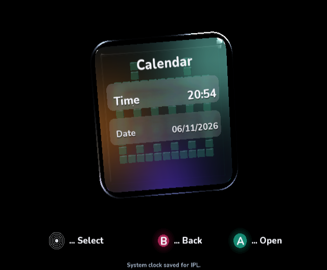

# Persistent settings and the real console calendar

The normal source-SDK build uses GC Loader SD for confirmed settings and IPL SRAM
for system time and stereo/mono. Review builds keep fixed, isolated state.

`clock/` contains unscaled native Dolphin 2503 EFB captures, input events, build
hash and the isolated emulator's raw SRAM. The managed GameCube DOL read the
current clock, edited hour/minute and committed a +3660-second bias. The SRAM
checksum and inverse checksum both match. A second negative-bias write also
passes both checksums; `sram-verification.json` preserves the exact results.




**Restart limitation:** the next capture shows the original wall time. Dolphin
2503 explicitly resets RTC bias in its EXI IPL constructor at startup. This is
preserved as evidence, not presented as a persistence pass. The final capture is
a relative decrement after that reset, not a restoration of the previous bias.
Physical power-cycle retention and the official IPL display require a console.
No host operating-system clock or physical console was changed.

The GC Loader device is unavailable in this emulator. The real SD adapter is
instead exercised against a host filesystem fixture: three-byte short reads,
newest generation after reopening, torn writes, corrupt records, one unreadable
slot, and write protection. No other storage is used as a silent fallback.
Real GC Loader firmware write support and retention remain hardware checks.

Menu tests cover saved startup output, unsupported-mode fallback, holding X to
bypass, previews/reverts not saving, successful Keep saving, and sound/motion.
Time edits preserve the current live date/seconds; date edits preserve live time;
B writes neither. A failed SRAM write stays in the editor with an error. A
successful SRAM write followed by a failed SD save reports both outcomes.

Build against the console-services SDK source checkout:

```sh
python ci/build_videomode_source_sdk.py --sdk /path/to/DolphinDotNet \
  --hypercube /path/to/hypercube-engine --output /path/to/build --normal \
  --icons --glass --blur --glyphs --tints --numbers --footer-text --grid \
  --selectors --console-services
```

The older published package remains buildable with unavailable real clock/sound
services. The source-integration DOL enables the actual console APIs.
