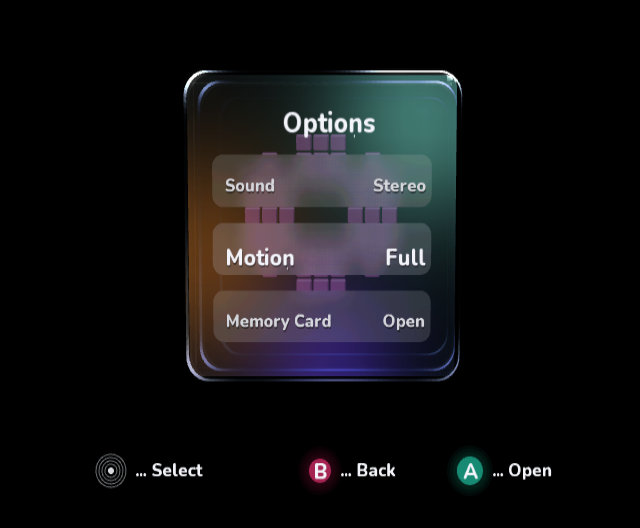
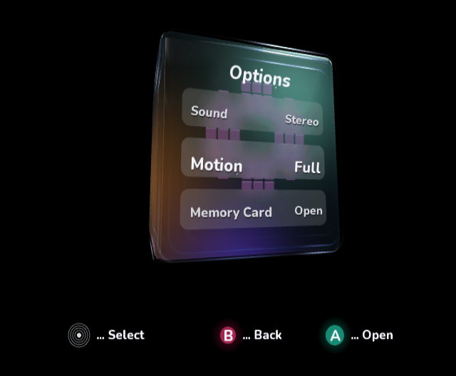

# Rounded-corner native review

The reference remains the [exact mockup](optical-glass-target.png). Its large
outer arcs and layered curved inner walls are visibly round at every corner.
The [previous accepted front](pass-35-native.png) used a 0.075 rounded-solid
radius and 0.075 optical-wall radius, which read almost square at native size.

The solid now uses radius 0.12 (flat core 0.88), while optical walls use 0.16 at
the outer boundary, tapering to 0.145 inside. The same 625-vertex face grids and
12 subdivisions per wall quarter-arc are retained. No managed buffers, textures,
or native meshes are added. Localized reflected lights expose the upper-right
and lower corner returns as well as the existing upper-left polish.

## Native comparisons

All implementation images below are unmodified GameCube DOL frame dumps from
cloud-local Dolphin 2503/OpenGL, 4× emulator MSAA. Raw 640×528 frame pixels are
preserved; compare their composition at the console's 4:3 display aspect.

The geometry-only [front trial](pass-42-native.png) and [angle trial](pass-43-native.png)
show broader arcs, but the lower/right corners remain too dark to convey their
curvature as clearly as the mockup. The second iteration adds localized corner
reflections without a continuous outline.

The broader silhouettes and curved wall returns are more visible in both poses.
The mockup still has finer refracted layering and stronger optical detail; this
change does not establish an exact rendering match. The procedural rotating cube,
row frost, controller flow and video preview/rollback are retained.

## Validation

The front and angle review DOLs both build and render natively. The normal
interactive DOL was then rebuilt and [booted in Dolphin](corners-interactive-native.png).
`VideoModeMenuTests`, managed VideoMode build, three repository validators,
native AOT/DOL/PowerPC ELF checks and `git diff --check` pass. The normal native
build has four existing toolchain warnings and no errors. Capture checksums are
recorded in [the native manifest](native-captures.sha256). Hardware frame rate
and physical-display acceptance remain unmeasured.
