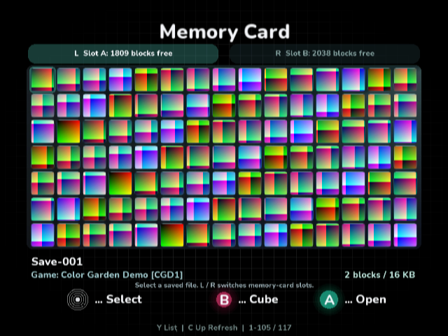
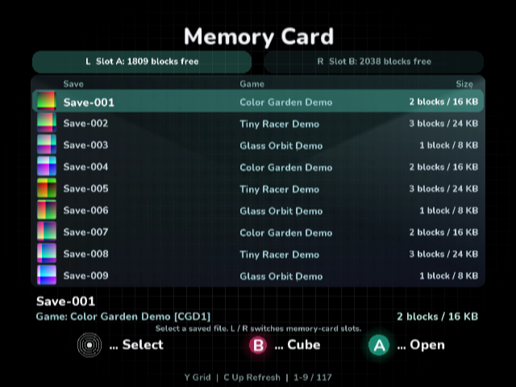
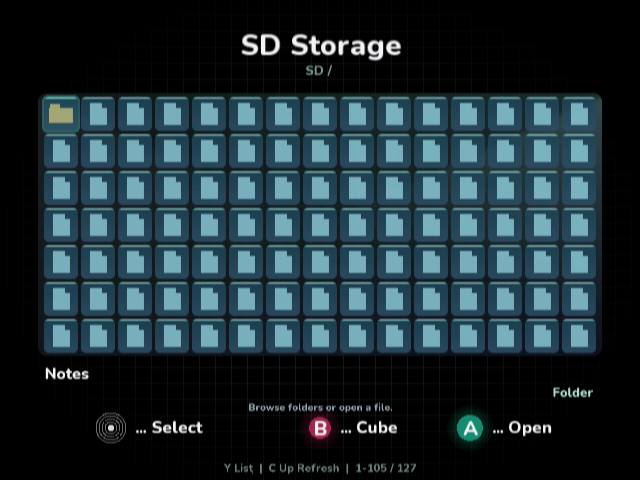
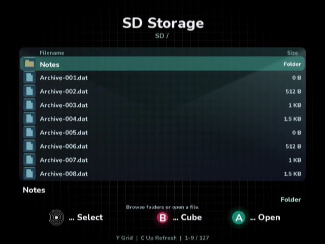

# Compact storage views

Memory-card and SD browsing share a 15-column, seven-row grid: 105 items per
page inside the existing margins. A 32×32 icon sits in a 36×36 rounded glass
cell. The selected filename and size appear below the grid. Memory cards also
show the save's title metadata and four-character game identity; a GameCode
fallback is used when title metadata is empty/unreadable. A save file occupies
one icon even when it uses multiple card blocks. One block is 8192 bytes (8 KB).

Y switches between that grid and a nine-row list, preserving the absolute
selected item. The memory-card list has Save, Game and Size columns. The SD
list has Filename and Size columns; an image's internal title does not replace
its filename. SD sizes use B/KB/MB/GB (1024-byte units); directories say Folder.
Each storage browser remembers its view for the session, including slot and
folder changes. C-stick Up refreshes; L/R select memory-card slots, and L opens
the SD parent folder. A opens and B returns directly to the storage cube side.
Y remains Rescan in the separate game library, which retains its large cards.

## Rendering and memory

The dense page uses one retained indexed mesh (420 vertices / 630 indices at
105 icons) and one 512×512 native RGBA8 atlas. Rounded glass cells and generic
file/folder icons are rasterized into the atlas between frames. Card icons
are read incrementally, at most one frame per application frame. Only the
selected save animates; its frames are cached in native storage. A single
rounded live nine-tap blur mask serves the page. No draw/upload is made per
visible icon during a static frame. All foreground text is batched after the
glass, artwork and footer geometry; row names retain their live focus animation.
Card atlas cells use absolute directory
indices, so loaded artwork survives paging and grid/list switches. Refresh,
slot changes and media revisions invalidate the cache.

The first native attempt exhausted the SDK's 256 KiB managed heap by retaining
all 105 saves' text. The accepted implementation uses a native directory
catalog and materializes one item for the grid or at most nine list rows.
SD filenames and 64-bit sizes use bounded native records (544 bytes per item,
including 256 UTF-16 code units). Only a 544-byte record scratch, kind bytes and
one 5184-byte tiled icon scratch are managed. A single off-selection card icon
uses transient metadata. The heap size has not been increased.

## Native review fixtures

`../storage/DenseCardFixture.cs.txt` is a separate, test-only native executable
that refuses nonempty cards, then writes 117 original saves to isolated
Dolphin slot A and two to B. Icons and titles are original synthetic test data,
not commercial save assets. The regular VideoMode DOL includes no fixture
writer. `native-fixture.json` records the successful native result and checked
persisted directory counts and one-/two-/three-block sizes.

`ci/make_dense_storage_disc.py` creates an original DVD filesystem with 127
root entries and a nested text preview. The storage-review build selects this
read-only DVD to exercise the real file browser; it is not a physical GC Loader
mount or a Swiss boot test. `review-provenance.json` records the input hashes.
Final captures read the completed native GameCube `GX_CopyDisp` framebuffer
from Dolphin after `GX_DrawDone`, stopped at the presentation boundary. The
original 640×480 YUYV422 buffers remain artifacts. `ci/decode_native_xfb.py`
uses standard BT.601 color decoding to make RGB PNGs, without crop, resize or
composition. `ci/native_frame_boundary.py` counts actual presentations and
checks that the guest remains paused during capture. These debugger sessions
are visual checks, not performance measurements. X11/EFB diagnostics remain
separate artifacts.

The cloud Dolphin captures still intermittently omit some captions, including
headings and selected-item details. This visual stability issue is unresolved;
it has not been confirmed on physical hardware. Functional navigation, sizes,
bounded memory and build checks pass, but this is not a complete visual sign-off.

The native review covers both layouts, selection-preserving switches, the
second memory-card and SD pages, slots A/B, default-Cancel save actions, nested
text preview, parent folders, a 1 MB file and an ISO whose internal game title
differs from its filename. C-stick refresh resets the page and B returns to
the cube. Both isolated raw card images and the input disc remain unchanged.

Host tests cover page boundaries, async page publication, preserved selection,
view/slot memory, bounded metadata retention, filename/64-bit size round trips,
SD parent paths, read-only contents and block/KB units. Native builds use the
existing source SDK and engine integration; this UI change adds no SDK or
engine APIs. VSync remains enabled.
