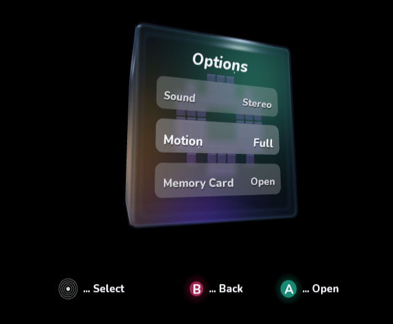
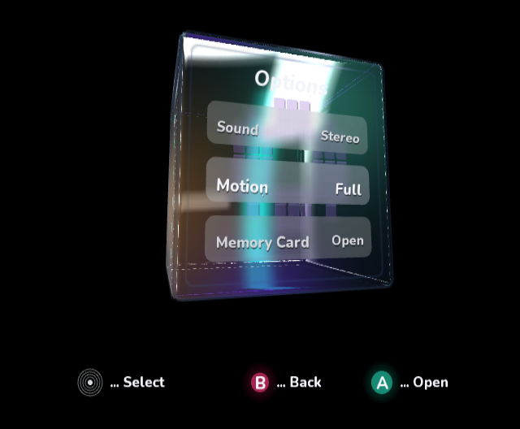
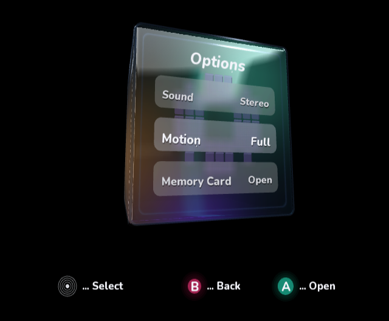
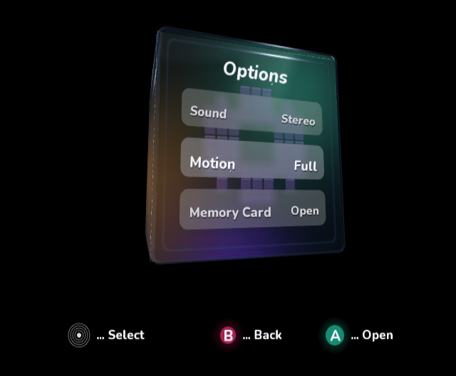
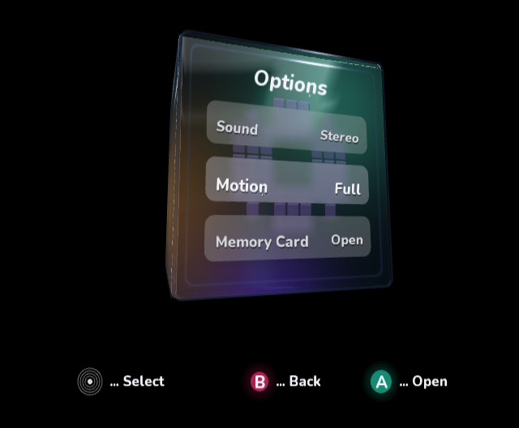
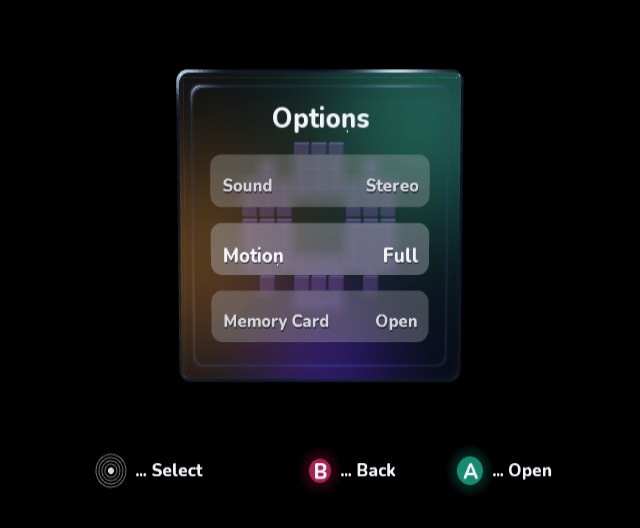
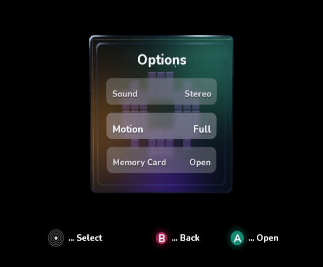

# Clear-glass reflection refinement

The [exact mockup](optical-glass-target.png) combines dark clear glass, colored
transmission and sharp studio-light reflections. The earlier native wall used a
broad vertex-lit bevel glow and wide smooth wall bands, making it read as frost.

## Implementation

- Added an original procedural 128×128 studio-light reflection map with crisp
  white panels and teal/violet accent lights. It contains no UI or mockup pixels.
  Regenerate it with `python3 VideoMode/Tools/generate_gloss_map.py`.
- Reflection coordinates use each rounded surface normal and perspective eye
  ray, so the sampled reflections move with the real cube geometry.
- A separate native TEV pass samples the map and multiplies RGB by a grazing-angle
  response. Additive GX blending uses RGB intensity, not source alpha.
- Transmission and wall shading precede the reflection layer. The old diffuse
  white bevel glow was removed, and the wall polish cross-section narrowed.
- The rows still capture and blur the actual backdrop after the reflection pass.
  Frost belongs to the rows; the underlying cube has no full-surface blur.

The existing shared mesh upload grid now includes UVs (15 KiB rather than 10 KiB).
Both mesh sets reuse it. An additional 625-entry Color32 response array costs
2.5 KiB; the compressed map is under 1 KiB. Textures and extra reflection meshes
live in native memory. Uploads remain outside GX passes. This adds six reflection
mesh draws; real hardware frame rate is unmeasured.

## Native validation findings

A direct float-to-byte-array assignment exposed a pinned SDK AOT lowering defect:
the emitted C used an eight-byte floating store into the byte array. The final
uploader stores whole Color32 structs instead. `ci/verify_aot.py` now rejects that
unsafe store in the VideoMode reflection uploader. The SDK itself was not patched.
The SVG geometry exporter explicitly omits native reflection textures and is not
used as visual acceptance evidence.

All images are actual DOL frame dumps from cloud-local Dolphin/OpenGL with the
same 4× MSAA profile as the previous AA pass. Complete frames were inspected;
no screenshot pixels were edited.

## Review progression

Before:

Pass 19 established texture reflections, but additive intensity was uncontrolled
and the title was overexposed:

Passes 20–23 were troubleshooting captures affected by the incorrect native
strength store, and are not accepted visual results:
[20](pass-20-native.png), [21](pass-21-native.png),
[22](pass-22-native.png), [23](pass-23-native.png).

Pass 24 corrected the native storage. The reflected light was visibly working,
but its broad gray cap was still too strong:

Pass 25 narrows the light and steepens the response to retain bright curved
polish with less milky coverage of the flat pane:

Pass 27 keeps the narrower light sources, raises their grazing-angle response,
and adds a second thin reflected strip. It retains more polished contrast than
pass 25 while avoiding pass 24's broad gray coverage:

Front-facing checks against the exact mockup:

This remains an approximation of the mockup's complex optical reflections and
refraction, not a pixel-perfect match. The native renderer now has a separate
sampled, view-dependent reflection layer rather than relying on diffuse lighting
lobes to suggest gloss.

## Validation

All three repository validators, all managed sample builds, all runnable sample
regression suites and both compile-only Kart intrinsic projects passed again.
Final managed and interactive native builds, the normal native boot capture,
and explicit packaged AOT/DOL/PowerPC ELF validation passed. The AOT safety guard
also rejects a negative fixture with the unsafe eight-byte store.

Normal interactive capture: [PNG](gloss-interactive-native.png). Hardware
performance and optical parity with the mockup remain unverified.
