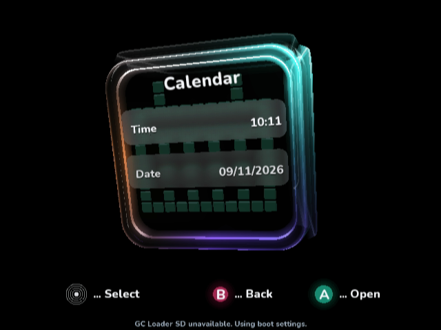
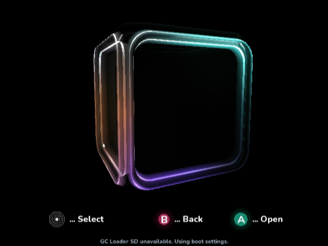

# Hollow optical glass

**Superseded:** this per-face frame design was rejected. The approved continuous
sealed-shell target and new native evidence are in [sealed-glass](../sealed-glass/README.md).

[Approved target](approved-target.png): the user's selected Calendar mockup.
The scene remains procedural and rotates between six independent menu sides;
the approved image is reference material, never a runtime backdrop.

## Material and shape

- Increase the rounded solid radius from 0.24 to 0.32 and the scene scale from
  106 to 118, preserving the existing menu layout and margins.
- Replace the nearly opaque colored face with clear transmission over a dark
  cavity. The two menu panels retain their actual captured-backdrop blur.
- Sweep six body bands and two narrow polish bands through a continuous convex wall profile, revealing
  thickness between its outer curved surface and inner optical return. Its
  colored lighting and two focused polish lobes replace the detached outline.
- Evaluate environment lighting once around each visible perimeter and reuse
  it across every wall band and its adaptive segments. Cache the invariant
  cross-section at construction. The existing indexed native buffers are reused.
- Separate glossy reflection strength from transmission alpha, retaining
  face-visibility fading. Making glass clear must not make its reflections dim.
- Apply the small viewing tilt after the menu-face orientation so Calendar
  reveals physical wall depth instead of merely rolling its labels.

The added profile/light arrays use about 1.5 KiB plus headers. Vertex colors
add 1.5 KiB per indexed quad stream (about 7.5 KiB total added payload after
all three selector caches exist). There are no per-frame array allocations.
The native color stream stores four RGBA values per quad instead of one, adding
up to 420 KiB of native color storage across the rim and all selector caches;
position and command capacities are unchanged. GPU vertex colors now interpolate
across and along the wall, using the unchanged triangle winding. Uniform
selector quads duplicate their original color at all four vertices.
The managed heap remains 256 KiB. Flat menus, editors, navigation, saved
settings, storage operations and video-switch preview/revert logic are unchanged.

## Native evidence

`iterations/01` records the hollow but excessively dark first material pass.
`iterations/02` records the brighter uncached material and its timing window.
Intermediate successful native builds for the cache and reflection changes
were not captured and are not presented as visual review passes.

The normal interactive DOL is reviewed using:

```text
ci/review_performance_overlay.py --rim-review --rim-profile --native-boundaries
  --sdk <source SDK> --dol <normal DOL> --logs <fresh directory>
```

The input sequence captures Calendar, an actual turning corner, Video,
A opening the flat page and B returning to the cube side. Native screenshots
come from completed GameCube XFBs in Dolphin 2503. Their PNG conversion uses
standard BT.601 decoding with no crop, resize or scene composition. Comparisons
resize only the reference image to 640×480; native screenshots stay unscaled.

The Y logger then records 30 warmup frames and 96 samples with no debugger
stops, screenshots, frame dumping or app storage writes during measurement.
VSync is enabled. CSVs and summaries use guest-clock microseconds, not physical
GameCube timings. Idle motion remains enabled, so the workload varies within
each window; this is not a fixed-pose causal benchmark.

| Native iteration | Frame mean | Preparation | Work excluding retrace |
| --- | ---: | ---: | ---: |
| 02: uncached light sampling | 68.469 ms | 56.261 ms | 58.456 ms |
| 05: cached perimeter light, camera-space tilt | 50.048 ms | 43.096 ms | 45.698 ms |
| 06: GPU gradient interpolation | 33.364 ms | 29.224 ms | 31.234 ms |
| 07: shared projected boundaries, joined walls | 33.364 ms | 25.680 ms | 27.593 ms |
| 08: six body bands + two fine polish bands | 33.364 ms | 26.351 ms | 28.263 ms |
| Final: wider native-resolution polish | 33.364 ms | 26.351 ms | 28.263 ms |

These windows also differ in material, pose and tessellation; their deltas are
not isolated causal measurements of a single optimization. Native frames and
CSV/provenance for each captured iteration are preserved. Physical hardware
acceptance is pending.

## Final result and limitations

[Final native captures](final) include Calendar, the rotating cube corner,
Video, A opening its flat page and B returning to the cube. All five saved
frames were inspected. [Build provenance](final/build.json) identifies the exact
interactive DOL. The final profile p95 is 33.367 ms, with 170,416 bytes of the
262,144-byte managed arena used after sampling and zero collections. This is
not a peak-memory measurement or a hardware frame-rate certification.




[Normalized mockup/native comparison](final/delivered-comparison.jpg) and
[focused comparison](final/delivered-focus.jpg) retain the visual differences.
The native walls are hollow and rounded, but reflection complexity, corner
junctions and fine-edge antialiasing remain below the generated mockup. The
root `design-qa.md` records these as remaining fidelity work. This PR remains a
draft; it does not claim pixel-perfect or physical-hardware acceptance.

Validation passed: complete menu/model tests, vertex-index color/winding/bounds
checks, 81 independent perspective-midpoint checks, pinned managed build, full
normal native build, generated-AOT/DOL/PowerPC-ELF verification, the three
repository validators, Python syntax and whitespace checks. Earlier captures
use real native outputs and are retained even where they expose regressions.
