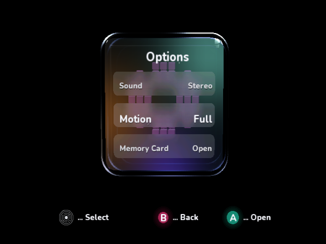
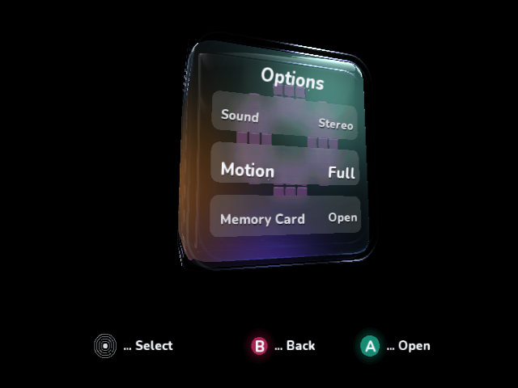

# Indexed optical-rim submission

The optical rims now use **GX indexed position/color arrays and a reusable GX
command list**. The cloud Dolphin measurements below show a net improvement,
including the geometry work moved to preparation. Physical GameCube timings are
still pending; emulator timings do not establish real console performance.

## Controlled native results

All values are mean milliseconds from 30 warmup plus 96 uninterrupted native
frames, with Z hidden, 640×480i, the same edge-AA shader and SDK
0.1.0-preview.217.1. No screenshots, frame dumping or debugger interrupts occur
during measurement. Raw CSVs, native captures and measured DOL hashes are retained.
The frontal baseline was repeated; the angled baseline is the preceding accepted
build's archived run with the same profiling method/configuration.

| Scene | Before frame | Indexed frame | Before work excluding VSync | Indexed work |
| --- | ---: | ---: | ---: | ---: |
| [Options baseline](indexed-rims/00-baseline/result.json) / [final](indexed-rims/03-final/result.json) | 50.048 | 33.365 | 43.458 | 31.597 |
| [Oblique baseline](performance-followup/08-angle-after/result.json) / [final](indexed-rims/04-angle-final/result.json) | 83.415 | 66.731 | 82.570 | 63.123 |

This is approximately **20 → 30 fps frontally** and **12 → 15 fps obliquely**
in Dolphin. Work outside VSync drops **27.3%** and **23.6%**, respectively.

The frontal app submission cost drops **39.017 → 11.777 ms**, while preparation
increases **4.403 → 19.783 ms**. The net work reduction is **11.861 ms**; the gain
is not simply moving a timing scope. Oblique submission drops
**70.832 → 16.365 ms**, while preparation rises **11.701 → 46.722 ms**.
Work excluding VSync is a frame-minus-retrace measure, not a separate GPU timer.

The [first frontal trial](indexed-rims/01-indexed/result.json) and
[first oblique trial](indexed-rims/02-angle/result.json) reproduce the final
presentation intervals. The final repeat retains telemetry compatibility with
the historical hardware baseline renderer.

## Why this indexing path

The published SDK's ordinary mesh fast path indexes uniform-color, unlit meshes.
The rims have varying segment colors; that mesh path expands them to direct
triangles. The older dynamic-mesh experiment also paid for vertex conversion,
validation and per-frame uploads and was slower. This change uses the published
raw GX API, with no SDK/package modification.

- Each visible quad stores **four XY positions and one RGBA color**, replacing
  two separate managed triangle submissions. Its two triangles retain the same
  winding and flat segment color; highlights are not averaged across segments.
- Separate 16-bit position/color indices reference those arrays. One immutable
  128-quad triangle command list is replayed against successive array offsets.
- A small managed chunk stages data; native writes and explicit cache flushes
  happen between frames. Replay sets vertex formats, alpha blending, matrices,
  viewport/scissor and TEV state in an exclusive raw pass. The vertex cache is
  invalidated on each array rebase. Managed drawing resumes afterward.
- A partial final chunk uses transparent degenerate padding. Draw/triangle
  counters explicitly include raw batches and padding, preserving the existing
  17-column CSV/BBA protocol. Counts rise from 102 to 119 submissions and 17,504
  to 17,632 triangles frontally; the speedup comes from reduced CPU staging and
  call overhead, not fewer reported draws or reduced tessellation.

Managed staging/command/matrix array data totals **7,824 bytes** plus object
headers. Bounded native buffer payload capacity totals **1,182,864 bytes**, including matrices
and the command list; at most 32,768 quads are accepted. Overflow is checked
before writes. These allocations happen once and are explicitly disposed.
No giant managed vertex array or per-frame allocation is introduced.

The Z panel separately lists **Rim geometry** under preparation and **Optical
rims** under submission. Older rim scope readings included geometry generation;
compare full preparation/submission/work totals when assessing the gain.

## Native visual and mode checks

Both final native captures are **pixel-identical** to their respective previous
renderer captures. Surface density, rounded corners, wall lighting, reflections,
81-tap frosted rows and antialiasing settings are unchanged.
[Pixel comparison counts](indexed-rims/comparison.json).

Both native scan acceptance sequences pass all 18 phases:
[480 sequence](indexed-rims/scan480-standard/result.json) and
[576 sequence](indexed-rims/scan576-standard/result.json). They cover i/p,
cross-resolution changes, keep/back, forced logical timeout and safe mode. Every
phase preserves its original, unscaled native frame-dump PNG. Their dimensions
can differ from the timing captures because Dolphin dumps resolved XFB output.

Disabling Dolphin's established progressive-presentation workaround exposed bad
interlaced presentation and a magenta safe-mode frame. A matched run of the
**previous renderer, revision 30f9256**, using the same configuration produces
the exact same magenta frame. This is a pre-existing failure in that diagnostic
configuration, not evidence of an indexed-rim regression. The standard acceptance
profile uses the workaround while the native driver asserts the actual requested
scan modes. Physical VI/cable acceptance remains open. The
[failed diagnostic](indexed-rims/native-fields-diagnostic/indexed-result.json),
[matched baseline](indexed-rims/native-fields-diagnostic/baseline-manifest.json)
and [identical bad-frame comparison](indexed-rims/native-fields-diagnostic/comparison.json)
are preserved rather than reported as a pass.

## Other validation

Managed compilation, linked menu/scan/rollback/shell/lighting/overlay tests,
native builds, AOT verification and repository validators pass. New command-list
tests check GX header/count, 32-byte alignment, index bounds, triangle winding,
independent segment colors and NOP padding. The bridge host tests pass (13
executed, one optional C fixture skipped locally).

The historical renderer compiles with current hardware instrumentation. Hardware
builds omit live-overlay drawing methods, avoiding a dependency on newer canvas
text methods in old baseline adapters. CI now checks that compatibility after
its optimized native callback builds. The normal interactive overlay remains
available on Z; raw counts feed the unchanged Y/BBA sample format.

The [normal interactive DOL/input manifest](indexed-rims/interactive/manifest.json)
retains nine inspected native captures: startup hidden, held Z, Options, A into
the editor, Z hidden, B/reopen, 16:9 preview/keep, 16:9 with Z hidden, and X back
to safe 4:3. The capture helper now supports `--widescreen` for these extra checks.
The window forces a 4:3 presentation even when the app's native aspect setting
is 16:9; it verifies the app's logical layout/controls, not a physical widescreen TV.

In the [Options overlay capture](indexed-rims/interactive/03-options-visible.png),
rim submission is about **0.06 ms**, while rim preparation is about **15.3 ms**.
These interactive snapshots use idle motion and frame dumping, unlike controlled
benchmarks. The overlay itself costs about 3.5 ms of CPU submission here and can
push Options from the 33.365 ms interval into the 50.048 ms interval. Hide Z for
baseline measurements; its own cost remains visible rather than silently subtracted.

[All managed sample builds/tests and three native AOT groups](https://github.com/capz/DolphinDotNet.Samples/actions/runs/42026646725)
and [Windows/Linux bridge tests, optimized callback builds and historical-renderer compatibility](https://github.com/capz/DolphinDotNet.Samples/actions/runs/42026646925)
passed for renderer revision `e819553`. No PR is merged and no physical GameCube
timing or VI-signal acceptance is claimed.
