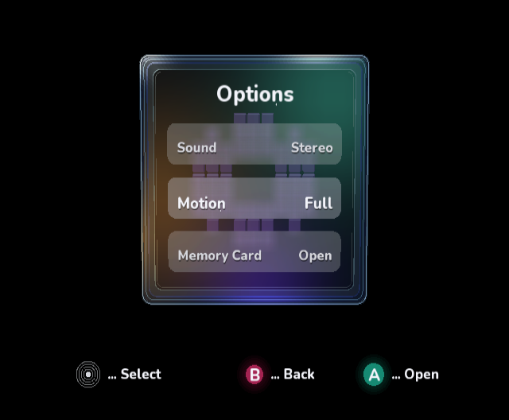

# Optical glass native review

Target: [exact mockup](optical-glass-target.png). This review continued
`codex/optical-glass-refinement` from
`10790baa7f4e23d057ae5df2b29ef2c9bb9691ba`, preserving passes 1 and 2.

The angled border-removal refinement is recorded in [the continued review](angled-review.md).

## Captures and findings

Passes 3–9 are actual GameCube DOL frame dumps from cloud-local Dolphin,
using the OpenGL backend under Xvfb with Mesa software rendering. They are
unmodified PNGs, not SVG exports, browser previews, or generated images.
The dump is 640×528 in native video pixels; account for the console pixel aspect
when comparing it with the 4:3 mockup. Passes 1–2 include emulator chrome;
compare their game viewport only.

| Pass | Native capture | Change and comparison with target |
| --- | --- | --- |
| 1 | [PNG](pass-01-native.png) | Existing tighter roundover; opaque/faceted rear walls remained. |
| 2 | [PNG](pass-02-native.png) | Existing projected boundaries; blue face and thin aliased lines remained. |
| 3 | [PNG](pass-03-native.png) | Captured the existing teal/amber/violet implementation before changing it. Lighting improved, but side walls overlapped the title. |
| 4 | [PNG](pass-04-native.png) | Suppressed nearly edge-on surfaces and layered the perimeter. Cleaner face; reflections still uniformly outlined. |
| 5 | [PNG](pass-05-native.png) | Spatial reflection colors and slightly higher/larger cube. Margins closer; rows still dark and compressed. |
| 6 | [PNG](pass-06-native.png) | Brighter/taller rounded frost, wider vertical spacing, higher title, 25 live backdrop samples. Better hierarchy and softer icon backdrop. |
| 7 | [PNG](pass-07-native.png) | Sampled long straight edges for localized glints; rounded individual icon blocks. More optical variation, but walls still lacked body. |
| 8 | [PNG](pass-08-native.png) | Added translucent wall ribbons, smooth facing opacity and repositioned footer. More depth; a faint side-wall trapezoid remained near the title. |
| 9 | [PNG](pass-09-native.png) | Additional cleanup: smooth opacity starts past the almost edge-on pose; concentrated upper-right teal light. Removed that overlap. |



The layout, layered rims, face lighting, row frost and footer are closer to the
mockup. This is not a pixel-perfect match: the target has substantially richer
reflections/refraction, smoother optical highlights and higher-resolution type.
The procedural approximation retains real rotation and menu geometry rather
than replacing the scene with a bitmap. Hardware frame rate has not been measured;
the frost now costs 25 native mesh draws rather than nine.

## Reproduction

Use the published SDK/package version pinned by the repository. Build the same
native renderer in its deterministic Options/Motion pose:

```sh
dotnet build VideoMode/VideoMode.csproj -c Release \
  -p:DndBuildNative=true -p:DndBuildBackend=Docker -p:IplVisualReview=true
```

Run `VideoMode/bin/Release/net8.0/VideoMode.dol` in Dolphin. For cloud capture,
the prepared `dnd-cloud-dolphin` image supplies Dolphin and Xvfb. Dolphin's user
configuration used:

```ini
# Config/Dolphin.ini
[Core]
GFXBackend = OGL
CPUCore = 1
CPUThread = False
[DSP]
Backend = No Audio Output
[Movie]
DumpFrames = True
DumpFramesSilent = True
```

```ini
# Config/GFX.ini
[Settings]
DumpFramesAsImages = True
InternalResolution = 1
AspectRatio = 2
```

Launch with `xvfb-run -a dolphin-emu-nogui -u USER_DIRECTORY -e DOL_PATH`.
Keep a complete `Dump/Frames/framedump_12.png`, then stop the emulator. Each
saved PNG was opened and inspected before presentation. Normal builds omit
`IplVisualReview` and retain the interactive cube, menu transitions and idle float.
No Windows desktop control was used.

The shared 625-vertex upload buffer remains in place. Additional wall/reflection
geometry is emitted procedurally; the extra blur taps reuse the managed panel
vertex buffer and snapshot. Resource uploads and capture allocation remain
between frames.

## Validation

- All three `ci/validate_*.py` manifest/run-config/test-link validators passed.
- All 16 managed sample applications built against the pinned public packages.
- All 10 runnable sample test projects passed. The two Kart host-intrinsic smoke
  projects compiled, following the repository workflow's compile-only policy.
- Final VideoMode menu/shell tests passed again after pass 9.
- Native review builds for passes 3–9 succeeded and each produced the shown frame.
- Final normal interactive native build succeeded and booted in Dolphin:
  [interactive cube capture](interactive-native.png).
- `git diff --check` passed.

The native toolchain emits existing SDK C/compiler warnings. No console hardware
run or hardware performance measurement was performed. GitHub workflow status is
reported separately on the pull request; local validation is not a claim that
remote CI has completed.
