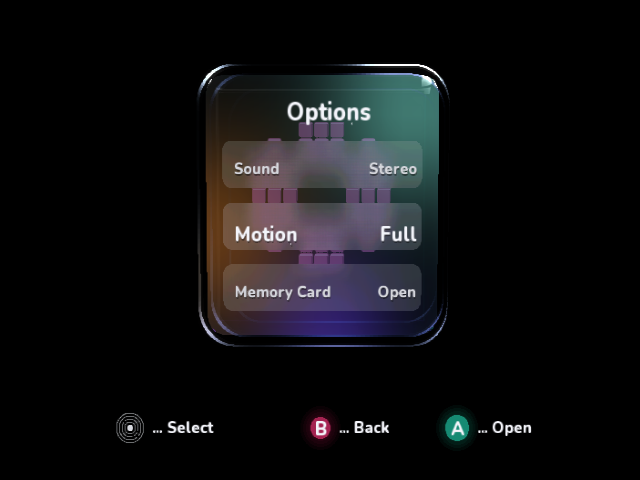
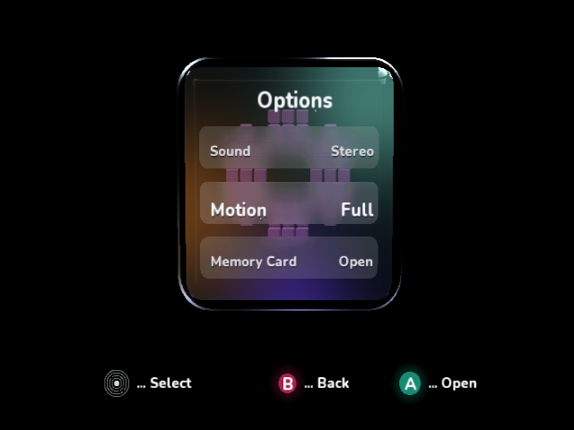
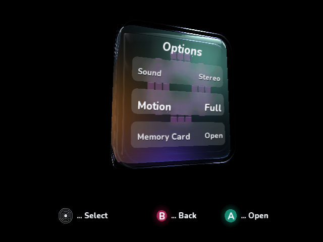
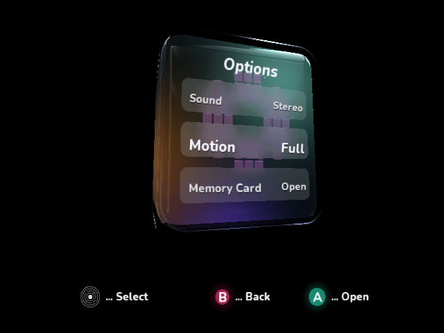

# Remove the inset optical rim

The middle and inset inner returns are removed completely. Only the narrow outer
polish remains. The renderer no longer constructs the former interior wall bands
or applies their ambient tint, secondary highlight or inner-exit highlight.

The outer three strips retain their original positions within the old 16-division
cross-section, rather than stretching across its former width. This preserves
the outer bevel and rounded silhouette while removing the nested interior border.
The cube's rounded surface, glossy reflection pass, live frosted rows, typography,
input handling and video switching paths remain in place. The tint array shrinks
from 16 entries to three; no allocation or native-buffer capacity is added.

## Native visual review

These are complete, unscaled native Dolphin 2503 window captures from the GameCube
DOL, with the overlay hidden. Each saved image was inspected after capture.

Before:

After:

Previous angled appearance (the subsequent geometry optimizations preserved this
appearance exactly):

After:

The separate inset highlight loops around the face have disappeared, especially
the nested lower-left/bottom returns. The outer corner arcs and surface reflections
remain visible. The appearance change is intentional; previous reports' claims
of pixel-identical optimization stages describe those historical stages.

## Native timings

Each new run uses 30 warmup and 96 uninterrupted native frames, fixed pose,
SDK 0.1.0-preview.217.1, Release/O3/LTO, 640×480i, MSAA 1 and the established
IplEdgeAA/Dolphin progressive-presentation configuration. No screenshots,
debugger interrupts, storage writes or competing builds occur during sampling.
The emulator is paused after sampling to extract RAM and capture its complete
window. These are **Dolphin guest-clock measurements, not physical GameCube results**.

| Scene, Z hidden | Frame mean / p95, ms | Preparation mean, ms | Work excluding VSync, ms | Draws / triangles |
| --- | ---: | ---: | ---: | ---: |
| Previous frontal | 33.364 / 33.365 | 17.788 | 29.601 | 119 / 17,632 |
| Outer-only frontal | 33.364 / 33.365 | 7.445 | 19.222 | 106 / 14,304 |
| Outer-only oblique | 50.048 / 50.048 | 17.821 | 34.160 | 128 / 19,424 |

The matched frontal control saves **10.38 ms** of work per frame, including the
reduced indexed submission. Its presentation interval stays at 33.36 ms because
of VSync. The previous oblique follow-up run used the visible overlay, so its work
figure is not a matched hidden-overlay control; no exact oblique CPU delta is
claimed here. Work means frame minus VSync wait, not total GPU execution time.

Raw [frontal](outer-rim-only/01-front/result.json) and
[angled](outer-rim-only/02-angle/result.json) reports retain DOL SHA-256,
mean/median/p95/max and environment, with sibling frame/overlay CSVs and native PNGs.
The matched frontal baseline is [the preceding hidden-overlay run](rim-generation/05-hidden/result.json).
Build with `IplPerformanceReview=true`, using `IplPerformanceReviewScene=Oblique`
for the angled pose, and pass the corresponding `--scene` to
`ci/profile_videomode.py --overlay Off`. Normal builds remain interactive.

Validation: menu/scan/apply/keep/revert/timeout/safe-mode/shell/overlay/lighting and
indexed-command tests pass, along with the managed build, frontal/angled native
review builds, normal interactive native build, AOT verification, all three
repository validators and diff whitespace checks. The normal native build keeps
the standard input loop; this edit changes only rim construction and lighting.
