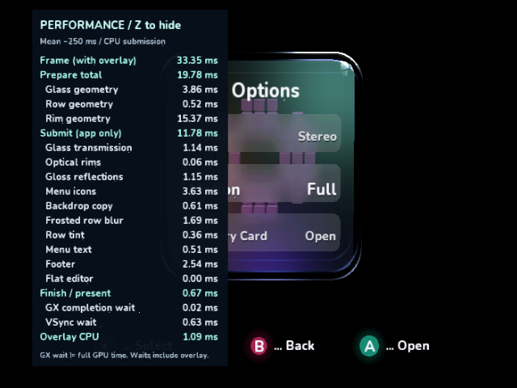
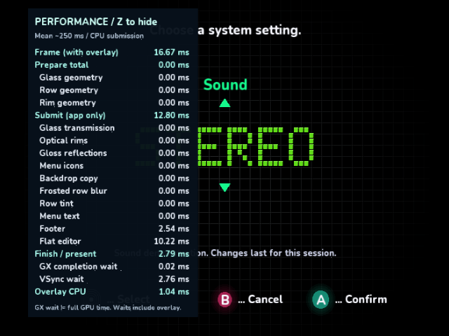
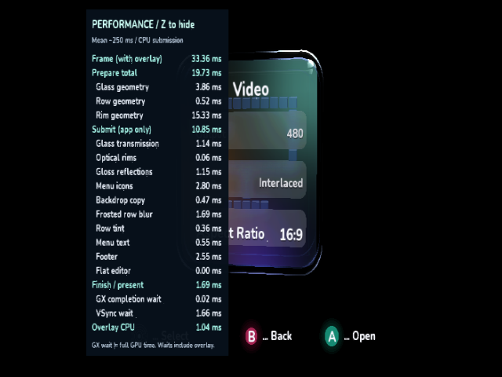

# Z overlay cost investigation

The original overlay added 3.55 ms of CPU work to an Options frame already using
31.60 ms. That crossed the 33.36 ms presentation deadline and the completed frame
rose to 50.05 ms. Most of the apparent extra frame time was the next VSync wait.
Caching the static label geometry reduces overlay CPU to 1.10 ms and restores
33.36 ms frames with Z visible. Hidden-overlay work remains unchanged.

These are **cloud Dolphin 2503 / Mesa llvmpipe guest-clock observations, not
physical GameCube results**. Each run uses 30 warmup plus 96 uninterrupted frames,
fixed Options pose, SDK 0.1.0-preview.217.1, Release/O3/LTO, MSAA 1 and the existing
IplEdgeAA presentation shader. No frame dumps, debugger interrupts or storage I/O
occur during the measurement window. The emulator is paused only after sampling
to extract RAM and capture the complete native window. GX completion wait measures
blocking at the fence, not the GPU's full execution time.

| Controlled native build | Frame mean / p95, ms | Work excluding VSync, ms | Overlay CPU, ms |
| --- | ---: | ---: | ---: |
| Original, Z hidden | 33.364 / 33.365 | 31.597 | 0 |
| Original, timers only | 33.364 / 33.373 | 31.612 | 0 |
| Original, full overlay | 50.047 / 50.056 | 35.236 | 3.546 |
| Cached labels, full overlay | 33.364 / 33.373 | 32.728 | 1.097 |
| Cached labels, Z hidden | 33.364 / 33.365 | 31.596 | 0 |

The timers-only control adds about 0.015 ms. Number formatting costs only
0.027 ms; neither explains the slowdown. The expensive part was regenerating and
submitting hundreds of immutable font glyphs every frame.

| Exclusive overlay component | Original, ms | Cached, ms |
| --- | ---: | ---: |
| Static labels | 2.099 | 0.081 |
| Numeric glyph submission | 0.802 | 0.792 |
| Number formatting | 0.027 | 0.026 |
| Final glyph batch flush | 0.561 | 0.156 |
| Whole overlay, including panel and transitions | 3.546 | 1.097 |

Overlay CPU falls 69%. App preparation/submission remain about 19.79/11.78 ms.
GX completion wait falls from 0.081 to 0.023 ms, and VSync wait from 14.811 to
0.636 ms. The overlay still has a measurable observer cost; hide Z for baseline
Y/BBA runs. Timing scopes, numeric values and their update frequency are retained.

The fixed labels are warmed once during canvas setup as five indexed native
meshes. They use the existing shared 625-vertex scratch array, a bounded 1,872-byte
managed index array and short setup-only index prefixes. There is no new managed
vertex buffer, per-frame upload, texture snapshot or reduced refresh rate.
The 393 static glyphs use approximately 117,216 bytes of native vertex/index
payload. Uniform colors select the SDK's fast indexed path; partial meshes submit
only real glyphs. The cache scales through the existing orthographic transform for
output changes and is disposed with the canvas. Hardware-runner builds exclude it.




The original and cached Options captures have **zero changed pixels outside the
numeric value rectangle** `(185,62)-(277,427)`. Values differ because the measured
times changed. The [comparison record](overlay-cost/static-comparison.json) retains
the mask and result. No images are resized or synthesized.

The rim measurements refer to a separate effect. Sixteen translucent shaded bands
span each visible face's rounded outer perimeter and inset inner boundary, with
outer, middle and inner polish highlights. These approximate a thick optical wall;
they are not physically traced reflection/refraction. The inner highlight can read
as an extra outline. In this pose, **Rim geometry** costs roughly 15.37 ms to
generate/project/shade/pack the bands, while **Optical rims** costs roughly 0.06 ms
to submit the prepared indexed command list. This overlay change does not alter
that effect or its geometry.

Raw [original full](overlay-cost/01-full/result.json),
[timers-only](overlay-cost/02-timers/result.json),
[hidden](overlay-cost/03-off/result.json),
[cached full](overlay-cost/04-cached/result.json) and
[cached hidden](overlay-cost/05-cached-off/result.json) reports include DOL SHA-256,
mean/median/p95/max and environment. Each sibling directory contains the unchanged
17-column frame CSV, separate six-column overlay CSV and native screenshot.
The Y/BBA wire format is unchanged.

To reproduce the original instrumented control, check out `7845b9d` in a separate
worktree and apply [baseline instrumentation](overlay-cost/baseline-instrumentation.patch).
For either renderer, build with:

```sh
dotnet build VideoMode/VideoMode.csproj -c Release -p:DndBuildNative=true \
  -p:DndBuildBackend=Docker -p:IplPerformanceReview=true \
  -p:IplPerformanceReviewOverlay=Full
```

Run `ci/profile_videomode.py --dol <snapshot>/VideoMode.dol --logs <fresh-directory>
--variant <name> --scene Options --overlay Full` inside the established native
Dolphin/Xvfb environment. The matching ELF must accompany the DOL. Repeat with
`Timers` and `Off` in both the build property and extractor option. Keep the
interactive drawing code reachable in all three modes to avoid dead-code changes
confounding the control. `OverlaySamples` is review-only, bounded RAM telemetry;
normal interactive builds retain only the existing display statistics.

Validation: menu/scan/apply/rollback/safe-mode/shell/overlay/lighting and indexed
command-list tests, managed build, normal and review native builds, AOT verification,
all three repository validators and `git diff --check` pass locally. The layout
test checks metric completeness, unique rows, alignment, wait-row colors and bounded
mesh slots. All nine full native [interactive captures](overlay-cost/interactive/events.json)
were inspected: default hidden; held Z (one toggle); Options; flat editor with
fresh zero cube scopes; editor hidden; reopened Options; 16:9 preview/keep with
aligned labels/values; widescreen hidden; X safe mode back to 4:3. The cloud window
is forced to 4:3, so widescreen captures verify logical placement/input rather than
a physical widescreen TV signal. Representative captures:




