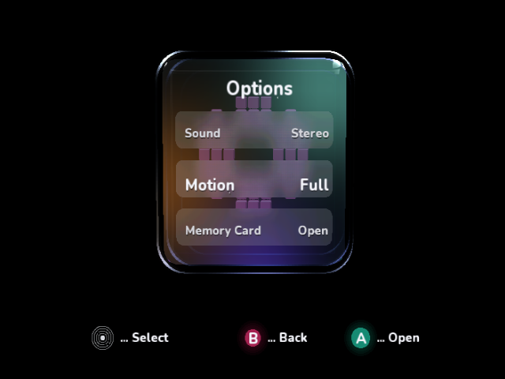
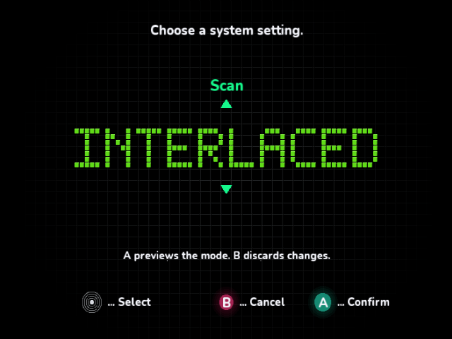
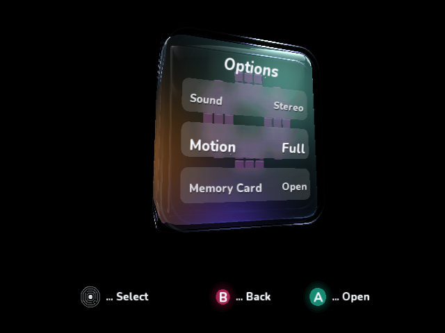

# Further native performance improvements

[The later indexed-rim pass](indexed-rims-review.md) improves frontal presentation
to 33.365 ms and oblique presentation to 66.731 ms in the same Dolphin setup.
This page retains the preceding baseline and incremental checkpoints.

These measurements use cloud Dolphin 2503, Mesa llvmpipe and the native guest
clock. They are **not physical GameCube frame-rate measurements**. The baseline
is the Z-overlay build, revision `9269a00`, with the overlay hidden. The BBA
hardware bridge remains available; no connected console supplied results here.

## Incremental Options measurements

Frame and work values below are means in milliseconds from 96 uninterrupted
native frames after 30 warmup frames. Work is frame time minus VSync/retrace
blocking, not an isolated CPU or GPU timer. Read the raw reports for p95/max.

| Checkpoint | Frame | Work excluding VSync | Prepare | Submit |
| --- | ---: | ---: | ---: | ---: |
| [Current baseline](performance-followup/00-current/result.json) | 50.048 | 48.942 | 7.529 | 41.376 |
| [Reuse view-space rim endpoints](performance-followup/01-view-space/result.json) | 50.048 | 47.649 | 7.537 | 40.076 |
| [Cache fixed curves and footer labels](performance-followup/02-static-curves/result.json) | 50.048 | 46.550 | 7.485 | 39.028 |
| [Native rectangles](performance-followup/03-direct-rectangles/result.json) | 50.048 | 46.539 | 7.485 | 39.017 |
| [Precompute shared glass attributes](performance-followup/07-canonical/result.json) | 50.048 | 43.458 | 4.403 | 39.017 |

The frontal face removes 5.484 ms of work, **11.2%**, but still reaches the same
50.048 ms presentation interval (about 20 fps in this emulator). The extra time
becomes VSync wait. It would be incorrect to call this an 11.2% frontal FPS gain.

1. Transform each optical-wall segment's endpoints once. Interpolate in view
   space and share those points between perspective projection and lighting.
2. Precompute fixed circle/panel directions, reuse wall directions for the menu
   icon's curved blocks, and select complete constant footer strings. This also
   removes repeated footer string concatenation. New direction arrays use 828
   data bytes; their segment counts are unchanged.
3. Submit axis-aligned rectangles through `Draw2D.FillRectangle`. The flat grid
   no longer normalizes line directions and submits two separate managed
   triangles per rectangle. Block text uses the same rectangle path. Painter
   order, alpha blending, grid spacing and fade are preserved.
4. Keep one canonical rounded face, its unit normals and curvature, orienting
   it to each cube side. Rotate each position/normal once and share the result
   across transmission, reflection UVs and projection. Vertex-array data drops
   from 45,000 to 17,500 bytes, saving **27,500 bytes**, and per-frame invariant
   normal/curvature calculations disappear.

The native surface still uses 625 vertices per contributing face, 24 divisions,
the same rounded shape, optical wall bands, reflection map, lighting lobes and
81-tap frosted-row blur. No SDK or AA settings change in this follow-up.

## Editor and angled scene checks

| Scene / raw report | Before frame | After frame | Before work | After work |
| --- | ---: | ---: | ---: | ---: |
| [Flat editor before](performance-followup/04-editor-before/result.json) / [final source](performance-followup/09-editor-final/result.json) | 33.365 | 16.681 | 26.978 | 13.345 |
| [Oblique before](performance-followup/06-angle-before/result.json) / [final glass](performance-followup/08-angle-after/result.json) | 100.098 | 83.415 | 95.618 | 82.570 |

The editor changes from approximately **30 to 60 fps in Dolphin**, with 50.5%
less work outside VSync. The oblique pose changes from approximately **10 to
12 fps**, with 13.6% less work. The editor comparison includes the first three
optimizations together; it does not isolate rectangle submission from curve
caching. Its [checkpoint after rectangles](performance-followup/05-editor-after/result.json)
and final-source repeat both reproduce 16.681 ms/frame and 13.345 ms outside
VSync. Glass preparation is inactive in the editor. The angled comparison
includes all four optimizations.

## Native visual comparison

All saved PNGs are full, unscaled 640×480 Dolphin X11 client captures, made
after the measurement window stopped at a complete presentation. No screenshots,
frame dumping, debugger interrupts, SD access or BBA traffic occur inside the
measurement window. Every run preserves all 96 rows and its measured DOL SHA-256.
The edge-AA shader and framebuffer configuration match across before/after runs.

The frontal captures at every checkpoint and the editor capture are
pixel-identical to their respective baselines. The final oblique capture changes
**five pixels by at most 1/255 in a channel**, consistent with floating-point
operation ordering. These comparisons are against the previous native renderer;
they do not establish a pixel-perfect match to the design mockup.
[Comparison counts](performance-followup/comparison.json).







## Reproduction

Use the same published SDK, optimized Release build, renderer, output mode and
scene on both sides of a comparison. Scene selection adds only deterministic
startup setup; the bounded profiler's 17-column schema is unchanged. The isolated
baseline worktree retains the original renderer/canvas and uses the same scene
setup added in `719ba58` for the editor and oblique comparisons.

```sh
dotnet build VideoMode/VideoMode.csproj -c Release \
  -p:DndBuildNative=true -p:DndBuildBackend=Docker \
  -p:IplPerformanceReview=true -p:IplPerformanceReviewScene=Oblique
# In dnd-cloud-dolphin/Xvfb, with the repository and artifacts mounted:
xvfb-run -a python3 ci/profile_videomode.py \
  --dol /absolute/path/VideoMode.dol --logs /fresh/log/directory \
  --variant shared-glass-attributes --scene Oblique
```

Choose `Options`, `Oblique`, `Cube` or `Detail`, matching the build property and
the profiling argument. The script verifies the native face/editor state. Keep
Z hidden for baseline measurements: its separately reported CPU cost and GPU
work can move a scene into another presentation interval.

Optical-rim generation/submission remains the largest measured CPU stage. The
angled result is still slow; physical BBA/Windows runner logs are needed before
using emulator rankings to certify a hardware improvement.

## Validation

The linked VideoMode menu, scan/rollback, shell, lighting and performance-overlay
tests pass. Managed Release compilation, normal interactive native DOL/ELF,
all measured native scene builds, AOT verification and repository manifest/run
configuration/test validators pass. The host geometry exporter also runs, but
is not evidence of native rendering. The captures and timing data above come
from the actual DOLs in Dolphin.

[Hardware bridge CI for renderer revision 71ade97](https://github.com/capz/DolphinDotNet.Samples/actions/runs/42003077872)
passed Windows/Linux host/protocol validation and optimized native callback builds.
[Full sample CI for the same renderer](https://github.com/capz/DolphinDotNet.Samples/actions/runs/42003077717)
passed all managed sample builds/tests and three native AOT groups. No PR is merged.

The normal interactive DOL was also run through the real emulated controller
input path: [startup hidden](performance-followup/interactive/01-default-hidden.png),
[held Z](performance-followup/interactive/02-z-held-visible.png),
[Options](performance-followup/interactive/03-options-visible.png),
[A into the editor](performance-followup/interactive/04-editor-visible.png),
[Z hides](performance-followup/interactive/05-z-hidden-editor.png), and
[B returns / Z reopens](performance-followup/interactive/06-reopened-options.png).
All captures were inspected. Overlay scopes clear in the editor and refill on
return; the SDK generic panel stays hidden. These interactive captures use
frame dumping and idle motion, so they are separate from controlled benchmarks.
[Interactive build hash and input events](performance-followup/interactive/manifest.json).
