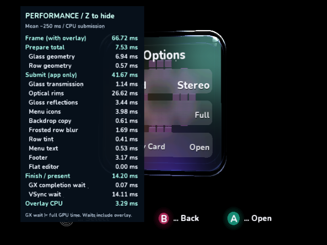

# Z performance overlay native review

Z opens/closes the app's detailed performance panel. Holding Z toggles once.
The SDK also handles Z for its generic panel; the app suppresses that panel to
keep the detailed readings unobstructed. The overlay starts hidden, works on the
cube, face menus and flat editor, and leaves A/B/navigation and Y recording intact.

The panel lists exclusive CPU submission scopes, their preparation/submission
totals, frame/presentation time, blocking GX completion and VSync waits, and its
own CPU drawing cost. Values are means of completed frames over approximately
250 ms. Scopes unused in a frame reset to zero. Reopening starts a fresh window.
No per-frame string formatting/allocation or storage/network access is added.
Overlay CPU is excluded from app submission; frame/presentation waits include
its GPU work. Buffered submissions can execute later, and GX wait is not total
GPU time. Hide the panel for baseline Y/bridge measurements.

These are native GameCube DOL captures in cloud Dolphin 2503, OpenGL/Mesa software
rendering and Xvfb, at 640×480 with the existing edge-AA shader. Each full X11
client was paused before capture and converted losslessly to PNG without resizing.
They verify appearance and input behavior, not physical GameCube performance.
Frame dumping and interactive input were enabled, so these readings are not a
controlled optimization benchmark. Build fingerprint and capture events are in
[manifest.json](performance-overlay/manifest.json).

| Native input/review step | Capture and result |
| --- | --- |
| Boot normally | [Hidden by default](performance-overlay/01-default-hidden.png) |
| Hold Z for two seconds, then release | [One visible panel](performance-overlay/02-z-held-visible.png) |
| Left opens Options | [Glass, rims, reflections, capture, blur, labels and footer measured](performance-overlay/03-options-visible.png) |
| A opens the flat Sound editor | [Glass/row scopes clear to zero; editor scope active](performance-overlay/04-editor-visible.png) |
| Press Z again | [Both detailed and SDK generic panels hidden](performance-overlay/05-z-hidden-editor.png) |
| B returns, Z reopens, continue for twelve seconds | [Fresh live readings, no stale editor cost](performance-overlay/06-reopened-options.png) |



Host menu/scan/shell tests and timing-state tests pass. The timing tests cover
startup visibility, toggling, stale scopes, averaging-window rollover and bounded
numeric formatting. Managed compilation, optimized native DOL/ELF build, AOT
verification and repository validators pass. The existing bridge host suite also
passes (13 executed, one C-interop fixture skipped in this invocation).

To repeat the interactive capture with a normal native build (no deterministic
review flags), in the cloud Dolphin image with libXtst available:

```sh
xvfb-run -a python3 ci/review_performance_overlay.py \
  --dol /absolute/path/VideoMode.dol --logs /fresh/capture/directory
```

The helper injects XTest keyboard events through Dolphin's GameCube controller,
not writes to application state. It preserves native EFB frames alongside the
window captures for checking complete frames. Inspect the saved screenshots
before presenting them. Physical controller/TV verification remains pending.
