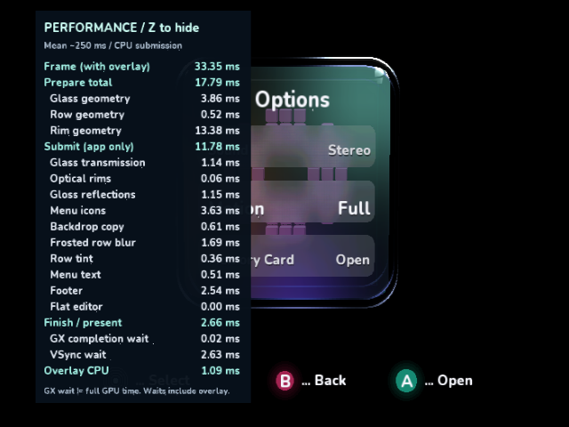
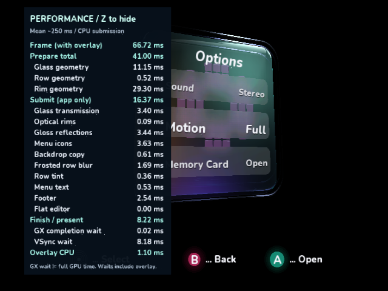
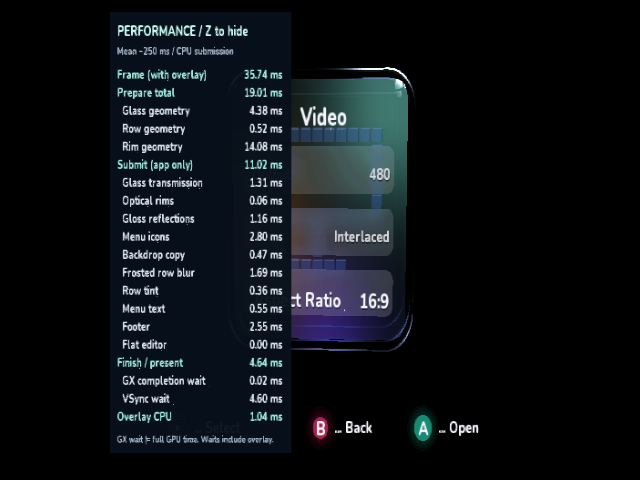
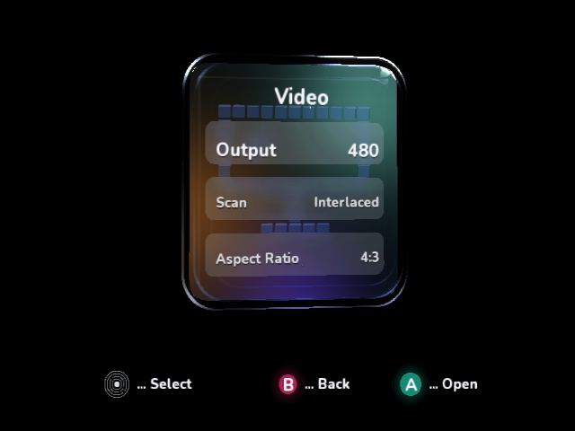

# Optical-wall generation follow-up

Three incremental native experiments reduce duplicate optical-wall construction
and work for transparent segments. The frontal Options scene saves **2.00 ms**
of work per frame; the fixed oblique scene saves **5.72 ms**. Neither crosses the
next VSync deadline, so presentation stays at 33.36 and 66.73 ms respectively.
These are **Dolphin guest-clock results, not physical GameCube performance**.

The [final hidden-overlay control](rim-generation/05-hidden/result.json) confirms
the saving without Z: work excluding VSync falls from 31.596 to **29.601 ms**,
preparation from 19.783 to 17.788 ms. Frame mean/p95 remain 33.364/33.365 ms and
counts remain 119 draws/17,632 triangles. Its native screenshot is pixel-identical
to the previous hidden-overlay capture across the **entire image, without a mask**.

The preceding [overlay investigation](overlay-cost-review.md) distinguished
expensive **Rim geometry** preparation from cheap indexed **Optical rims** submission.
This follow-up optimizes preparation. The separate inset boundary and polish
lobes remain part of the simulated thick glass wall. Their appearance, rounded
corners, tessellation, lighting, reflections and AA settings are retained.

| Options, Z visible | Prepare mean, ms | Rim geometry display, ms | Work excluding VSync, ms | Frame mean / p95, ms |
| --- | ---: | ---: | ---: | ---: |
| [Cached-overlay baseline](overlay-cost/04-cached/result.json), `9f0d1d3` | 19.786 | 15.37 | 32.728 | 33.364 / 33.373 |
| [1. Shared boundaries](rim-generation/01-shared-boundary/result.json) | 19.232 | 14.82 | 32.175 | 33.364 / 33.373 |
| [2. Early light cutoff](rim-generation/02-light-cutoff/result.json) | 18.451 | 14.04 | 31.393 | 33.364 / 33.373 |
| [3. Visible-segment work](rim-generation/03-visible-work/result.json), `7ab3681` | 17.790 | 13.38 | 30.733 | 33.364 / 33.373 |

The individual steps save approximately 0.55, 0.78 and 0.66 ms. Rim scope readings
come from the live mean in each saved native capture; full-frame preparation and
work figures are means from the retained 96-row logs. Frontal app submission stays
at 11.783 ms and the cached overlay at 1.097 ms. Draw/triangle counts stay at
126/18,708, including the overlay and indexed-list padding.

| Oblique, Z visible | Prepare mean, ms | Rim geometry display, ms | Work excluding VSync, ms | Frame mean / p95, ms |
| --- | ---: | ---: | ---: | ---: |
| [Baseline](rim-generation/00-oblique/result.json), `9f0d1d3` | 46.724 | 35.02 | 64.263 | 66.731 / 66.740 |
| [All three changes](rim-generation/04-oblique/result.json), `7ab3681` | 41.001 | 29.30 | 58.541 | 66.731 / 66.740 |

Oblique app submission remains 16.371 ms; counts remain 157 draws and 26,134
triangles. The reduced preparation is real CPU headroom, absorbed by a longer
VSync wait in these fixed poses. It is not an observed frame-rate increase.

## Changes and bounded memory

1. Adjacent wall bands reuse their shared boundary, already rotated into view
   space. Neighboring segments also consume those rotated endpoints. A single
   52-point scratch ring adds **624 managed data bytes**, plus its array header.
   Band zero initializes it for every face and frame. No canonical wall grid,
   larger native buffer or per-frame allocation is introduced.
2. `Light` checks the same `distance >= 16` cutoff as `ExpNegative` before entering
   that managed-array lookup. Distant narrow lights return exactly the same zero.
   The generated AOT C confirms the cutoff precedes the lookup call.
3. Final zero-alpha segments skip RGB calculation and color packing. Perspective
   projection and inner-edge interpolation are deferred until a visible segment
   needs them. A visible run retains its projected endpoint; a run after a gap
   reconstructs the exact preceding sample, preserving topology and flat colors.
   Lighting and the adaptive sampling count are still evaluated at the same points.

Indexing, GX state, native uploads, capture/blur, display application/rollback,
input handling and the Y/BBA telemetry format are unchanged. The renderer remains
interactive during rotation rather than substituting a pre-rendered picture.

## Native comparisons

Every frontal trial and the final oblique trial have **zero changed pixels outside
the numeric timing rectangle** `(185,62)-(277,427)` against their corresponding
baseline. The changing numbers are the only masked region. Raw unscaled native
windows were captured after sampling and verified before presentation. The
[comparison record](rim-generation/comparison.json) retains pixel counts and masks.

An additional **host geometry check** compares the previous renderer with the new
one across 864 combinations: all six previous/current faces, four turn fractions,
three animation times and both reduced-motion settings, reusing each renderer
across cases. All **2,053,606 quads** retain identical counts, ordering, colors and
XYZ coordinates. [Result](rim-generation/geometry-comparison.json) and
[comparison harness](rim-generation/geometry-comparison.cs.txt). This checks shared
geometry and cache reuse, and is not native performance or screenshot evidence.
To reproduce, compile that harness in a temporary .NET 8 console project linking
the current renderer/shell/menu/stats/lighting/font sources. Extract only the
`IplRenderer` class from `git show 9f0d1d3:VideoMode/IplRenderer.cs`, rename it and
its constructor to `BaselineRenderer`, and add that reference class to the project.

All native timing runs use SDK 0.1.0-preview.217.1, Release/O3/LTO, 640×480i,
MSAA 1 and the existing IplEdgeAA shader on cloud Dolphin 2503/Mesa llvmpipe.
The emulator's progressive-presentation workaround is unchanged. Each run has
30 warmup and 96 uninterrupted measured frames. There are no screenshots,
debugger interrupts, dumps or file writes during the measurement window, and no
competing builds during sampling. Mean/median/p95/max, raw 17-column frame CSV,
separate overlay CSV and DOL SHA-256 are in each linked trial directory.
Work means frame minus VSync wait, not total GPU execution time.

For each trial, build with `IplPerformanceReview=true` and
`IplPerformanceReviewOverlay=Full`, then run `ci/profile_videomode.py --overlay Full`
with the matching DOL/ELF. The oblique build also sets
`IplPerformanceReviewScene=Oblique`; pass `--scene Oblique` to the extractor.
Each archived `01-*.patch`, `02-*.patch` and `03-*.patch` applies independently to
the baseline renderer at `9f0d1d3`, making the incremental variants reproducible.

## Validation

Managed/menu/scan/apply/keep/revert/timeout/safe-mode/shell/overlay/lighting and
indexed-command tests pass, as do the managed build, normal interactive native
build, frontal/oblique review builds, AOT verification, all three repository
validators and diff whitespace checks. All three archived patches pass
`git apply --check` against a clean baseline checkout.

All nine [normal native input captures](rim-generation/interactive/events.json)
were inspected: startup hidden, held Z toggles once, Options visible, A opens the
flat editor with fresh zero cube scopes, Z hides it, B returns, Z reopens, widescreen
preview/keep preserves label/value alignment, hide works after the mode change,
and X safe mode restores 4:3. The normal scene remains animated. The forced 4:3
Dolphin window verifies logical widescreen placement/input, not a physical TV
aspect or VI signal. Mode-transition captures are input checks, not controlled
performance samples. The existing 36-phase scan acceptance evidence is linked
from the [indexed-rim review](indexed-rims-review.md); this follow-up changes no
video configuration path and makes no new physical-console acceptance claim.

