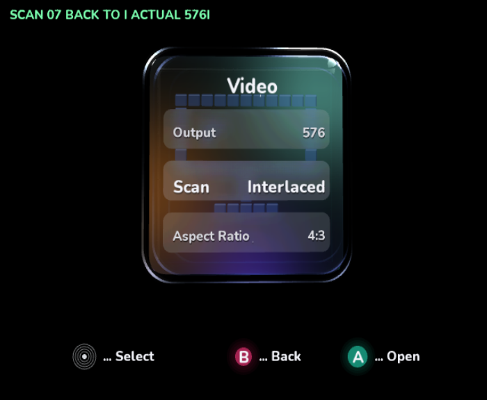
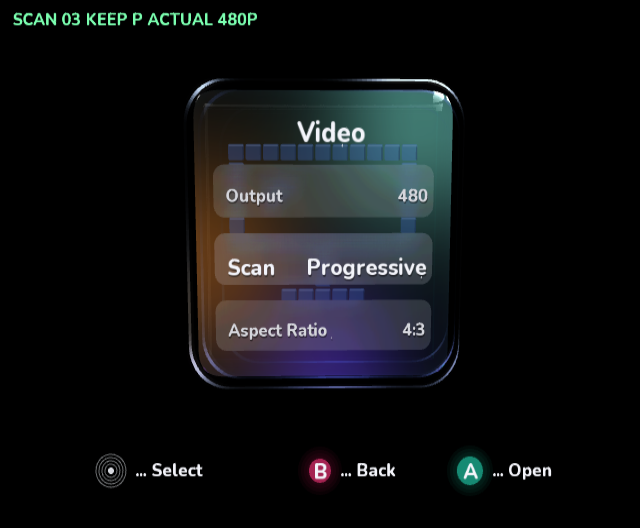

# Native scan-mode verification

The updated acceptance sequences cover both **480i/480p and 576i/576p**, plus
480p/576p resolution changes, in cloud-local **Dolphin [master] 2503**, OpenGL,
4× MSAA, SDK/GameCube package **`0.1.0-preview.217.1`**. The SDK update includes
the VIDEO blanking correction from
[SDK PR #151](https://github.com/capz/DolphinDotNet/pull/151). The actual GameCube
DOL invokes the same shell/editor/preview code as the interactive application.
Each phase asserts `GraphicsDevice.Display` readback, applied mode, preview state
and rollback state. The capture script OCRs the diagnostic caption and preserves
each original emulator PNG byte-for-byte. This verifies the SDK's resolved mode;
it is not an electrical measurement or a physical TV acceptance test.

| Sequence | Native result |
| --- | --- |
| At 480 and 576: interlaced → preview progressive → keep | Passed |
| At 480 and 576: progressive → preview interlaced → keep | Passed |
| Interlaced → preview progressive → B restores interlaced | Passed |
| Progressive → preview interlaced → B restores progressive | Passed |
| Progressive → preview interlaced → timeout restores progressive | Passed with forced logical 12.1-second tick |
| 480p ↔ 576p resolution preview, keep and B rollback | Passed |
| Safe mode after the resolution sequence | Passed; resolves to 480i, 4:3 |

The timeout checks the real rollback path with an advanced logical clock. It does
not measure 12 seconds of wall time. Host tests additionally cover rejected output
and rollback allocation failures. The review driver uses the normal shell and
output adapter; there is no special 576p policy bypass.





[480 sequence, SDK version, DOL and PNG hashes](scan-modes/sdk-fixed/480/result.json).
[576 sequence, SDK version, DOL and PNG hashes](scan-modes/sdk-fixed/576/result.json).
Both sequences have 18 stages and independent DOLs.

## SDK fix and app behavior

480i, 480p, 576i and 576p are available through the normal menu. The temporary
576p rejection, forced interlaced resolution for 576 Auto and diagnostic bypass
have been removed. Auto follows the SDK's timing/cable rules. Unsupported output
and allocation failures retain the existing transactional error/rollback paths.

The original freeze was caused by libogc2 black timing: 1218 half-lines overflowed
a 10-bit pre-blanking field and disrupted VI interrupts. The SDK redistributes the
overflow between pre/post blanking while preserving field length, and bundles the
corrected VIDEO object in its verified native overlay. Updating the package and
rebuilding the native DOL is required; old DOLs are unchanged. No app-side native
patch or installed-toolchain modification is used.

The original preview.103.1 [480 passing report](scan-modes/480/result.json) and
[576 failure report](scan-modes/576-unqualified/result.json) remain as historical
evidence. The old 576 run stalled after phase 6 at frame 95. Local packages built
from fixed SDK commit `51b426b5d7620e4a67b39472b37d16e2e085255d` first confirmed
that the full optical-glass app continued through that rollback successfully.

Dolphin's default `GFX.Hacks.ForceProgressive=True` presentation workaround remains
enabled in the passing captures. It does not set the SDK's requested/resolved VI
scan mode. Disabling it produced invalid magenta interlaced captures on this
bundled emulator; the capture script's `--native-fields` option exists only for
diagnosis. Physical output and interlace-field presentation remain unverified.

## Reproduction

Build and capture from the repository root in an environment with the native
Docker toolchain, image `dnd-cloud-dolphin` (Dolphin and Xvfb), Pillow and tesseract:

```sh
dotnet build VideoMode/VideoMode.csproj -c Release -p:DndBuildNative=true -p:DndBuildBackend=Docker -p:IplVideoModeReview=true
python3 ci/capture_scan_modes.py --logs /tmp/scan-480-review --resolution 480
```

Use a fresh evidence directory. The isolated profile advertises component output
using `-C SYSCONF.IPL.PGS=True`; without it, progressive is correctly rejected.
The evidence uses raw frame dumps, not a browser/SVG proof or resized substitute.

To run the 576 acceptance sequence, build with the additional
`-p:IplVideoModeReviewResolution=576`, then capture with `--resolution 576`.
The watchdog fails the test if frame production stalls. Both resolutions exercise
the same app path, without a capability bypass.

Rebuild without either review property for the normal interactive DOL. Review
builds have no controller interaction; their caption and driver are absent from
the normal native AOT output. `IplVisualReview` and `IplVideoModeReview` cannot be
combined.

## Final validation

The normal interactive native build links and boots with no review driver or
caption in its generated AOT C. [Updated normal boot capture](aa-performance/interactive-native.png).
All 16 managed sample builds, ten runnable test projects, two compile-only Kart
intrinsic projects, three repository validators, explicit packaged AOT compilation
and DOL/PowerPC ELF checks passed. Invalid review-property combinations are rejected.
The normal native build retains four existing toolchain warnings and no errors.
