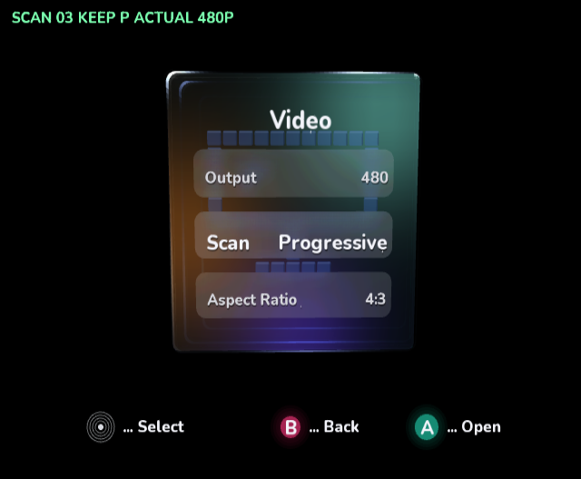
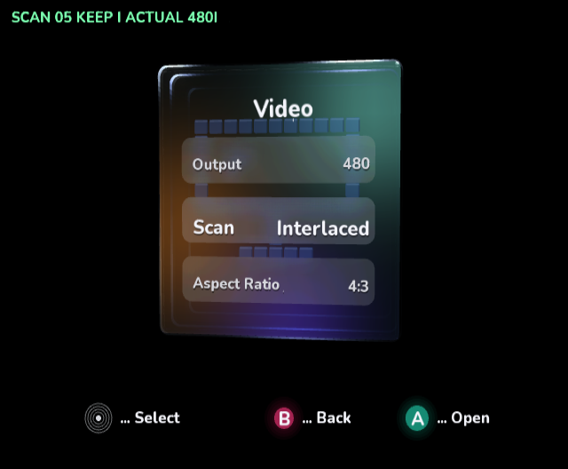
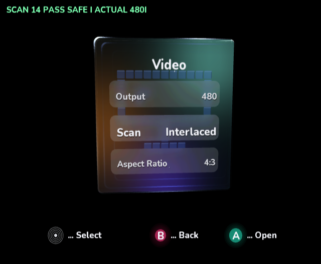

# Native scan-mode verification

The 480 sequence passes all 14 phases in cloud-local **Dolphin [master] 2503**,
OpenGL, 4× MSAA, SDK/GameCube package `0.1.0-preview.103.1`. The actual GameCube
DOL invokes the same shell/editor/preview code as the interactive application.
Each phase asserts `GraphicsDevice.Display` readback, applied mode, preview state
and rollback state. The capture script OCRs the diagnostic caption and preserves
each original emulator PNG byte-for-byte. This verifies the SDK's resolved mode;
it is not an electrical measurement or a physical TV acceptance test.

| Sequence | Native result |
| --- | --- |
| Release gate rejects 576p while at 480i | Passed; output remains 480i |
| 480i → preview 480p → keep | Passed |
| 480p → preview 480i → keep | Passed |
| 480i → preview 480p → B restores 480i | Passed |
| 480p → preview 480i → B restores 480p | Passed |
| 480p → preview 480i → timeout restores 480p | Passed with forced logical 12.1-second tick |
| Safe mode from 480p | Passed; resolves to 480i, 4:3 |
| Repeated 576i/p switching, PAL fallback region | Incomplete; frame production stalled at frame 95 after phase 6 |

The timeout checks the real rollback path with an advanced logical clock. It does
not measure 12 seconds of wall time. Host tests additionally cover rejected output
and the 576 Auto/interlaced release policy. Fake-output 576 tests validate menu
logic only; they do not qualify native 576p.





[All 14 passing phases and PNG SHA-256 hashes](scan-modes/480/result.json).
[Incomplete 576 diagnostic and retained phases](scan-modes/576-unqualified/result.json).
The two reports record their individual DOL hashes; they were separate builds.

## Release behavior and unresolved 576p

480i and 480p remain selectable. Normal interactive builds reject explicit 576p
before calling the output adapter and show an unavailable message. At 576, Auto
resolves to interlaced, preventing the SDK from selecting unqualified progressive
timing. 576i remains available. No SDK or NuGet binaries were patched.

The 576 stall reproduced with PAL fallback region and with Dolphin's progressive
XFB presentation workaround disabled. Its exact cause has not been isolated
between the pinned native runtime and this emulator. The diagnostic explicitly
bypasses the guard to help reproduce it; it is not a release capability switch.

Dolphin's default `GFX.Hacks.ForceProgressive=True` presentation workaround remains
enabled in the passing captures. It does not set the SDK's requested/resolved VI
scan mode. Disabling it produced invalid magenta interlaced captures on this
bundled emulator; the capture script's `--native-fields` option exists only for
diagnosis. Physical output and interlace-field presentation remain unverified.

## Reproduction

Build and capture from the repository root in an environment with the native
Docker toolchain, image `dnd-cloud-dolphin` (Dolphin and Xvfb), Pillow and tesseract:

```sh
dotnet build VideoMode/VideoMode.csproj -c Release -p:DndBuildNative=true -p:DndBuildBackend=Docker -p:IplVideoModeReview=true
python3 ci/capture_scan_modes.py --logs /tmp/scan-480-review --resolution 480
```

Use a fresh evidence directory. The isolated profile advertises component output
using `-C SYSCONF.IPL.PGS=True`; without it, progressive is correctly rejected.
The evidence uses raw frame dumps, not a browser/SVG proof or resized substitute.

To reproduce the **known failing** 576 diagnostic, build with the additional
`-p:IplVideoModeReviewResolution=576`, then capture with `--resolution 576`.
The watchdog stops the emulator after stalled frame production. This build
intentionally bypasses 576p qualification and must not be shipped as interactive.

Rebuild without either review property for the normal interactive DOL. Review
builds have no controller interaction; their caption and driver are absent from
the normal native AOT output. `IplVisualReview` and `IplVideoModeReview` cannot be
combined.

## Final validation

The normal interactive native build links and boots with no review driver or
caption in its generated AOT C. [Normal boot capture](scan-modes/normal-interactive-native.png).
All 16 managed sample builds, ten runnable test projects, two compile-only Kart
intrinsic projects, three repository validators, explicit packaged AOT compilation
and DOL/PowerPC ELF checks passed. Invalid review-property combinations are rejected.
The normal native build retains four existing toolchain warnings and no errors.
