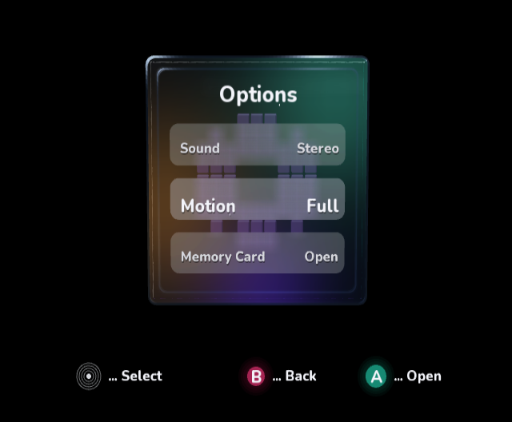
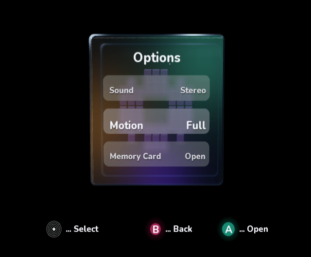
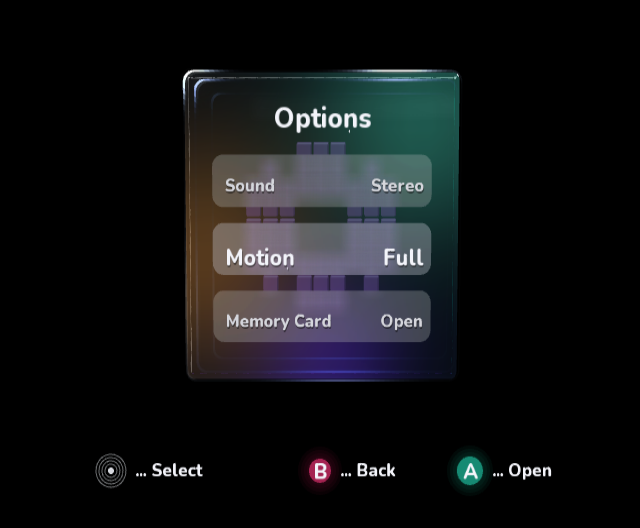
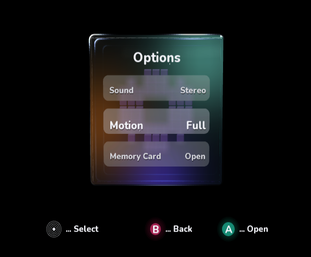
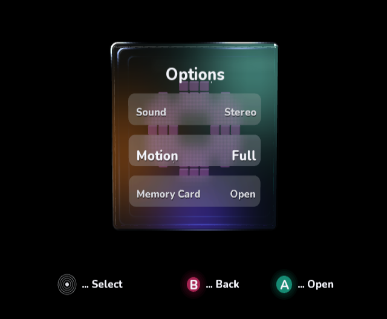
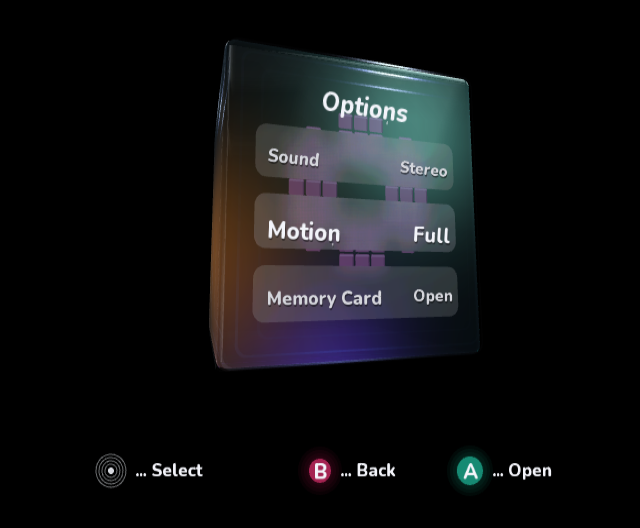

# Six-pass mockup comparison, native passes 30–35

Continues commit `68cb0548d07785152a7cf1b18ec4cdcaca5ecf91` against the
[exact mockup](optical-glass-target.png). All implementation images are native
GameCube DOL frame dumps from cloud-local Dolphin/OpenGL with 4× emulator MSAA.
The 640×528 raw video pixels must be viewed at the console's 4:3 display aspect
when comparing positions with the 1448×1086 mockup. No screenshot is edited.
Each accepted refinement is committed with its final native capture. The last
pass also retains its initial trial and angled validation captures.

## Pass 1/6 — native pass 30

Adjusted projected width/center, panel width, label/value anchors and selected
text growth. These bring layout and focus hierarchy closer to the mockup. The
material still reads as a thin frame, with insufficient optical wall depth.

## Pass 2/6 — native pass 31

Deepened the optical cross-section and offset its transmitted inner boundary.
The wall reads thicker and less symmetric. The inner boundary is still too
uniformly blue, and corner highlights remain weaker than the mockup.

## Pass 3/6 — native pass 32

Added localized layered polish, a third optical cross-section lobe and restrained
chromatic separation. Increased reflection exposure and enlarged a studio light.
The uniform blue frame is subdued and corners are brighter. Left polish still
outweighs the right, and the face lighting is darker/browner than the target.

## Pass 4/6 — native pass 33

Rebalanced and localized transmitted teal/amber/violet light, and repositioned
the upper-right reflected studio light. At fixed corresponding unblurred patches,
upper-right native RGB is `(60,118,110)` versus target `(63,119,111)`; left amber
is `(95,52,17)` versus `(95,55,21)`. These local samples do not imply a global
image match. Row frost is still too pale/grid-like and the gear is too low.

## Pass 5/6 — native pass 34

Raised/reshaped the gear, warmed its purple tone, moved the title down and
introduced a wider weighted blur with less opaque row tint. Title/gear placement
is closer, but the sparse 25-tap wide kernel exposes a repeated sampling grid.
The final pass must address this regression rather than treating it as accepted
frost quality.

## Pass 6/6 — native pass 35, with final front/angle validation

Used a dense 9×9 weighted kernel to remove the sparse blur grid, refined title
width/placement, trimmed row tint, deepened the inner wall and calibrated face
colors. Denser blur reuses the managed vertex buffer and immutable snapshot;
81 native meshes replace 25. Empty-panel frames skip these uploads.

The first angled check exposed excessive flat-pane glare. Curvature weighting
now reduces that glaze while retaining polished bevels. The initial front and
angle trials are retained for honest comparison:
[initial front](pass-35-initial-native.png),
[angle before glare correction](six-pass-angle-before-glare-fix-native.png).
The accepted final front capture was recaptured after that correction.

The front layout and sampled face colors are closer. Complex optical refraction,
fine corner details and the exact high-resolution mockup appearance remain
unmatched. These captures do **not** establish pixel-perfect parity.

## Validation and cost

All three CI validators, all managed sample builds, all ten runnable sample tests
and both compile-only Kart intrinsic smoke projects passed again. Final managed,
review and normal interactive native builds, native boot, explicit packaged AOT,
DOL/PowerPC ELF validation and the reflection-store safety check passed. Remote CI
status is tracked separately for the pushed PR head.

[Normal interactive native capture](six-pass-interactive-native.png).

The 9×9 frost increases native blur draw count to 81; native meshes retain their
own buffers while the managed upload buffers are reused. This remains within the
managed heap in the captured native runs. Real hardware frame rate has not been
measured. Dolphin's 4× MSAA is emulator AA, not a new hardware-AA mode in the DOL.

## Final point samples

These compare corresponding display positions, not cropped/recolored images.
They measure only five points and are not a global similarity score.

| Region | Target RGB | Final native RGB |
| --- | --- | --- |
| Upper-right face | 63, 119, 111 | 63, 119, 111 |
| Left amber | 95, 55, 21 | 95, 55, 21 |
| Lower violet | 53, 40, 119 | 49, 33, 107 |
| First-row frost | 94, 87, 107 | 98, 89, 109 |
| Selected-row frost | 73, 75, 78 | 82, 74, 86 |

[All pass sample values and coordinates](six-pass-samples.json).
