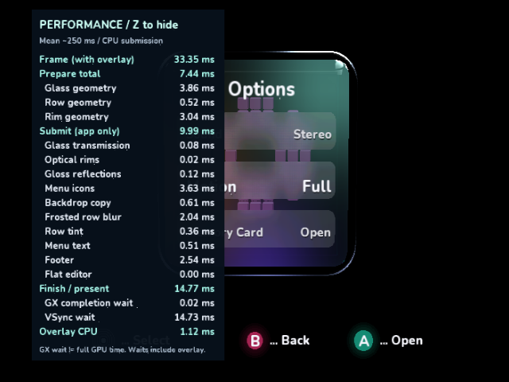
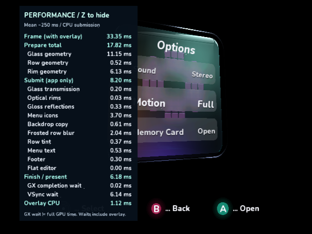
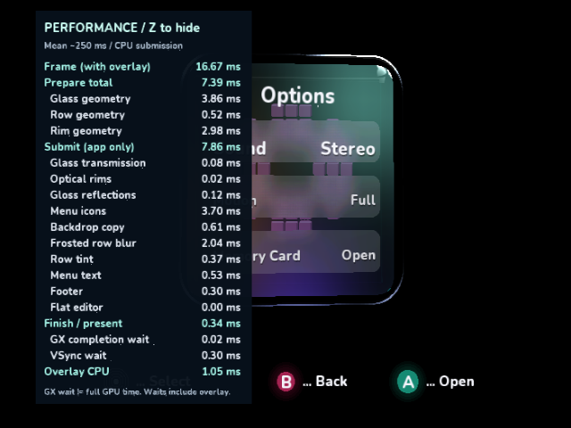
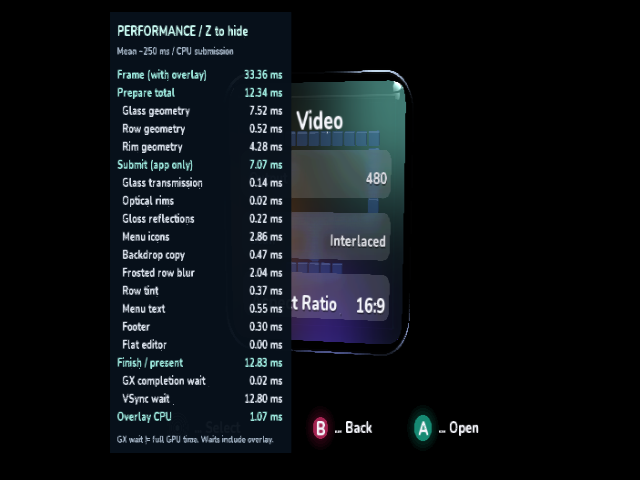

# GPU submission follow-up across Samples, SDK and Hypercube

The remaining app submission cost is real CPU work: the SDK expands varying-color
mesh indices into direct triangles, the footer regenerates immutable circles and
glows, and face icons still project/tessellate their blocks each frame.

Separate changes are reviewable in
[DolphinDotNet #154](https://github.com/capz/DolphinDotNet/pull/154) and
[Hypercube #8](https://github.com/capz/hypercube-engine/pull/8), alongside this
sample's footer cache. No PR is merged or package published by this work.

## Controlled native results

All frontal runs are fixed Options, Z visible, SDK .217, Release/O3/LTO,
640x480i, MSAA 1 with the existing IplEdgeAA presentation shader on Dolphin
2503/Mesa llvmpipe. Each uses 30 warmup plus 96 uninterrupted native frames.
No screenshots, debugger interrupts, frame dumps, storage writes or competing
builds occur during measurement. **These are Dolphin guest-clock observations,
not physical GameCube measurements.** Work means frame minus VSync blocking,
not total GPU execution time.

| Increment | App submission, ms | Work excluding VSync, ms | Frame mean / p95, ms |
| --- | ---: | ---: | ---: |
| [Baseline](submission-followup/00-baseline/result.json) | 11.746 | 20.354 | 33.364 / 33.373 |
| [SDK indexed-color prototype](submission-followup/01-sdk-indexed/result.json) | 9.993 | 18.625 | 33.364 / 33.373 |
| [Footer cache, stock SDK](submission-followup/02-footer/result.json) | 10.163 | 18.771 | 33.364 / 33.373 |
| [Footer + SDK prototype](submission-followup/03-combined/result.json) | 7.851 | 16.468 | 16.681 / 16.690 |
| [Combined, oblique](submission-followup/04-angle/result.json) | 8.209 | 27.215 | 33.364 / 33.373 |

The standalone sample cache saves 1.58 ms of submission. The standalone SDK
prototype saves 1.75 ms. The combined frontal gain is 3.90 ms, enough to cross one
VSync deadline: about 30 to 60 fps in this fixed scene. Its margin is only
**0.21 ms**, so it does not establish animated 60 fps. The combined oblique scene
still presents at 33.36 ms. Its baseline screenshot had Z hidden, so no matched
oblique CPU delta is claimed.

Frontal glass submission falls roughly 1.14 to 0.08 ms, gloss 1.15 to 0.12 ms,
and footer 2.54 to 0.30 ms. The backport's blur stage regresses approximately
1.69 to 2.04 ms; the table includes that cost. Preparation remains about 7.45 ms.
The current sample's default package pin remains .217: its standalone footer
cache retains 33.36 ms frames. The 16.68 ms result requires the SDK prototype.

## SDK path and integration control

The SDK PR sends indexed position, RGBA8 color and UV attributes from the native
mesh allocation, rather than expanding varying-color vertices on the CPU. It
requires unlit/authored-UV geometry with identity material tint. Nonwhite tint
retains the exact integer multiply/divide-by-255 fallback, as do lighting and
generated UVs. Color-layout/source changes invalidate the GX vertex cache;
uniform and direct transitions preserve channel/descriptor state. There is no
extra persistent geometry allocation.

These numbers are a **controlled native-bundle backport**, not a benchmark of an
unpublished package or a full SDK upgrade. The prototype helper from the SDK PR,
including main's source/layout tracking, is applied to copied .217 bundles using
[apply-runtime-prototype.py](submission-followup/apply-runtime-prototype.py).
Only native backend glue changes; the compiler and managed API remain pinned.
Draw-count instrumentation is adapted because .217 counts inside `draw_state`
while current main counts at GX submission. Installed packages are untouched.

To reproduce, snapshot the DOL/ELF and native bundle for each app variant, copy
the bundle, apply that helper with `--bundle <copy> --sdk <SDK-PR-checkout>`, and
run the pinned libogc2 image's `make -j2` with that copy mounted at `/work`.
Run `ci/profile_videomode.py --overlay Full`, matching the Options/Oblique build
scene. Raw CSVs, environment, hashes and captures are retained per increment.

## Sample cache and native comparisons

The footer warms three immutable shape variants between frames: cube selection,
face/editor A+B, and reverting B-only. It reuses the shared 625-vertex staging
grid with a bounded 624-entry index array. Eight native meshes use approximately
188,064 bytes of vertex/index payload. No geometry upload/allocation happens
during drawing. Only labels and the selected footer variant remain dynamic;
the GPU scales canonical positions for output changes. All meshes are disposed.

The cached shapes precede their non-overlapping text regions, preserving alpha
order within the rings/glows. All three frontal experiments are pixel-identical
outside the numeric timing rectangle. The oblique comparison excludes the whole
overlay panel and its AA fringe because the earlier capture had Z hidden.
[Masks and exact pixel counts](submission-followup/comparison.json).

## Hypercube engine path

`IndexedMeshCache` retains exact used vertex/index prefixes by content revision.
The existing dynamic buffer already skips unchanged revisions; the new helper
adds shared indexed vertices without capacity padding for stable assets. A dirty
commit replaces immutable native storage, so frequent vertex animation should
keep the in-place dynamic buffer. Failure preserves the previous mesh/revision.

The rendering fixture's terrain changes from 1,536 duplicated vertices to 289
shared vertices plus 1,536 indices, keeping 512 triangles. Native payload drops
55,296 to 13,476 bytes (75.6%); managed arrays drop 36,864 to 13,476 data bytes.
The deliberate frame-120 color edit now colors one shared vertex consistently.
Dirty uploads remain two. No engine frame-time speedup is claimed from those
storage figures. The actual engine DOL builds against the source SDK and passes
the native rendering validator, separately from the .217 timing backport.

## Next worthwhile targets

- **Menu icons: ~3.70 ms.** Cache canonical rounded-block geometry per icon and
  apply the changing cube pose/projection on GX. Caching projected screen points
  would incorrectly freeze animation; this needs native moving-pose comparisons.
- **Glass preparation: ~3.86 ms frontal / 11.15 ms oblique.** Transmission and
  gloss upload the same positions/UVs twice with different colors. Shared native
  attribute streams and partial color updates could avoid duplicate conversion,
  validation and upload while retaining the between-frame update contract.
- **81-tap frost: ~2.04 ms in the prototype.** Cache immutable index command lists
  and submit per-tap color/UV variants in one native call, reusing common world
  and projection state. This can preserve all taps; it needs state-restoration,
  texture-capture and hardware tests before broadening the SDK API.
- **Tinted varying-color meshes.** Current exact fallback remains intentional.
  Pre-tinted native color caches or a proven equivalent TEV formulation need
  bounded memory and color/alpha rounding evidence before replacing it.

GX completion blocking is about 0.02 ms in these scenes, which is not a measure
of the GPU's full execution time. The profiling evidence identifies CPU work;
physical hardware acceptance remains pending.

## Verification

Sample menu/scan/apply/rollback/safe-mode/shell/overlay/lighting/index-list tests,
all repository validators, managed build and normal native AOT verification pass.
The SDK's color-index, mesh-prefix, bulk submission and GX render-state fixtures
pass, as do phase-one/two AOT/GC graphics tests. Hypercube's cache boundary tests
and existing core checks pass. Its real rendering DOL passes the strict validator
with all cover states, exactly two uploads and progress beyond the retirement gate.

Nine complete [native interactive captures](submission-followup/interactive/events.json)
were inspected using the normal input loop and combined runtime prototype:
startup hidden, held Z toggles once, Options, A opens the editor with fresh scopes,
Z hides, B returns, reopen, widescreen preview/keep, hide in widescreen and X safe
mode back to 4:3. The scene remains animated. Widescreen input captures are logical
layout checks in the fixed 4:3 cloud window, not physical VI-signal acceptance.

