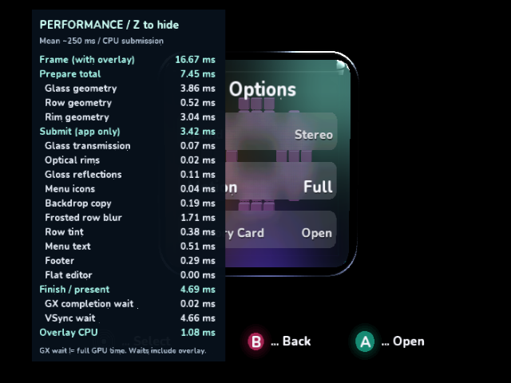
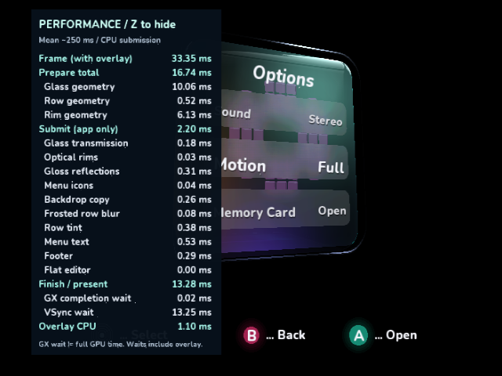

# Native submission review, round 2

These are **real GameCube DOLs in cloud Dolphin 2503 / Mesa llvmpipe**, measured
with the guest monotonic clock. They do not establish physical GameCube frame
times. Each run warms 30 frames, then records 96 without debugger interrupts.
The full Z timing overlay stays enabled in every table row. `active_us` is frame
elapsed time minus VSync wait; it includes overlay CPU, copies and GX waits.
It is not a separately measured full GPU duration.

The baseline is Samples `c974c03` with SDK `1449ca6`, including the previous
indexed varying-color backend and footer cache. Source snapshots were frozen
before changes. Later rows use the same scene, resolution and 81 blur samples.
The source integration build does not modify NuGet pins or replace packages.

| Increment | Frame ms | Prepare ms | Submit ms | Blur ms | Work excluding VSync ms |
|---|---:|---:|---:|---:|---:|
| 00-baseline | 16.681 | 7.448 | 7.473 | 1.707 | 16.063 |
| 01-icons | 16.681 | 7.454 | 3.421 | 1.710 | 12.017 |
| 02-glass | 16.681 | 7.091 | 3.421 | 1.710 | 11.655 |
| 03-blur | 16.681 | 7.090 | 1.800 | 0.087 | 10.034 |

- Icons: immutable canonical face-plane triangles in native buffers; GX performs
  cube projection from two matrices. The menu icon scope falls from about 3.72 ms
  to 0.04 ms. Submission falls 4.052 ms, including a 0.428 ms reduction in the
  subsequent backdrop-copy scope. That scope includes draining earlier GPU work;
  its reduction is not a separate optimization to the copy operation.
- Glass: one full geometry update plus an independent four-byte RGBA stream,
  replacing two full geometry updates. Saves 0.362 ms preparation in the front
  view and **161,472 bytes (~158 KiB)** over six native mesh pairs. The native
  view retains owner storage safely. No managed geometry array was enlarged.
- Blur: Hypercube's ordered plan invokes the new SDK native loop once. Each of
  the same 81 UV/weight variants still replays a GX draw in order. Submission
  falls 1.622 ms; the blur scope falls 1.710 to 0.087 ms. The optimized count
  remains 111 GPU draws / 15,486 triangles, including transparent icon padding.
- Combined: submission falls 75.9%; work excluding VSync falls 6.029 ms (37.5%).
  Displayed frame time stays 16.681 ms because VSync absorbs the saved work.

## Native captures and visual comparison

The images below are unscaled captures of the paused Dolphin window. The timing
overlay covers x=40..282, y=12..453; a comparison masks only that rectangle.
All four front-view images are **pixel-identical everywhere outside it**. This
claim does not compare the covered pixels. The angled and interactive checks
below exercise the new projection and other menu faces.





These changes preserve the current outer-rim-only rendering. They do not
reintroduce an inner inset rim or change the approved roundover, sample weights,
row layout, typography or lighting design. The [exact mockup](../optical-glass-target.png)
still has greater optical depth, more continuous gloss and softer block lighting
than the current renderer. This is a CPU submission improvement, not evidence
of a perfect visual match to the mockup.

## Angled scene

| Pose | Frame ms | Prepare ms | Submit ms | Work excluding VSync ms |
|---|---:|---:|---:|---:|
| Baseline oblique | 33.364 | 17.823 | 7.716 | 26.695 |
| Optimized oblique | 33.364 | 16.741 | 2.201 | 20.113 |

The same uncovered-pixel comparison is identical at this angle too. Preparation
saves 1.082 ms with three visible glass faces; submission saves 5.515 ms. The
frame still misses 16.7 ms: geometry preparation alone takes 16.741 ms, including
10.06 ms glass and 6.13 ms rim geometry in the displayed averaged scopes. A 60 Hz
claim at all cube angles would be unsupported. These optimizations leave that
CPU geometry work as the next substantial target.




## Build and reproduce

`IplCachedIcons` defaults to true and works with the existing published SDK pin.
The two new SDK APIs are opt-in until their PR is released; normal package builds
retain their existing glass/blur path. Build an explicit source integration:

```sh
python3 ci/build_videomode_source_sdk.py --sdk /path/to/DolphinDotNet \
  --hypercube /path/to/hypercube-engine --output /tmp/videomode \
  --icons --glass --blur
```

Omit feature flags for controls. Add `--scene Oblique` for the angled pose and
`--normal` for the normal interactive app. Without `--hypercube`, the same
sample calls the SDK plan directly. The source SDK must contain
[DolphinDotNet #155](https://github.com/capz/DolphinDotNet/pull/155); the optional
adapter comes from [Hypercube #9](https://github.com/capz/hypercube-engine/pull/9).
Every result JSON records its DOL SHA-256. CSVs retain all 96 frames and overlay
sub-scope samples, so the measurements can be independently recomputed.

## Validation

- Menu/scan regression tests: navigation, A/B, preview/keep/revert/timeout,
  independent time/date segments, 480/576 interlaced/progressive round trips,
  SDK Auto mode and safe mode passed.
- Managed VideoMode build and normal native build against the unchanged public
  package pin passed. Review and normal native builds against the explicit
  source SDK passed, including the optional Hypercube native adapter.
- Sample manifests, run configurations, test links and whitespace checks passed.
- SDK C suite passed, including the new shared-lifetime and ordered-pass fixture;
  relevant resource/GX/submission fixtures also passed with O3/LTO. New managed
  bindings passed Debug/Release AOT with GC stress. Existing display, graphics
  phase one/two AOT/GC, model/native/AOT, texture/effect and compiler integration
  checks passed; the remaining graphics smoke builds also passed.
- Hypercube core rendering/catalog tests, 36 Python tests, portable ordered-pass
  tests (including a cold material's lazy options), and published/source backend
  builds passed. The new native adapter was exercised in the DOL above.

Hosted CI runs separately on all three draft PRs; local checks do not imply
hosted CI has completed. An initial SDK CI inventory failure was corrected by
identifying the scheduled fixture in the inventory; no check was weakened.

## Normal interactive native review

The normal DOL was driven through the real Dolphin controller path, with at least
six rendered frames per press and 45 after release. This prevents short presses
from being missed on a slow cloud renderer. The saved captures show:

- [Default cube, overlay hidden](interactive/01-default-hidden.png).
- [Z held, one toggle](interactive/02-z-held-visible.png), then
  [Options](interactive/03-options-visible.png).
- [A opens the editor](interactive/04-editor-visible.png),
  [Z hides its overlay](interactive/05-z-hidden-editor.png), and
  [B returns to Options](interactive/06-reopened-options.png).
- [16:9 preview kept](interactive/07-widescreen-kept.png),
  [16:9 with Z hidden](interactive/08-widescreen-hidden.png), and
  [X restores 480 interlaced / 4:3 safe mode](interactive/09-safe-mode.png).

The fixed 640x480 capture window displays the native 16:9 signal anamorphically;
a widescreen display stretches it to the intended aspect. No native screenshot
was resized or stretched for this report. `interactive/events.json` retains the
completed-frame counts and `build.json` identifies the exact normal DOL.
