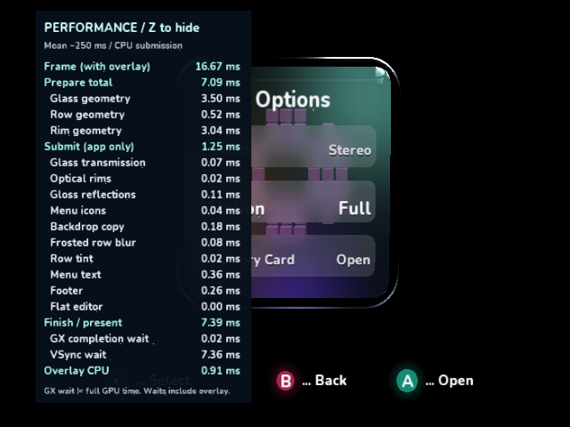
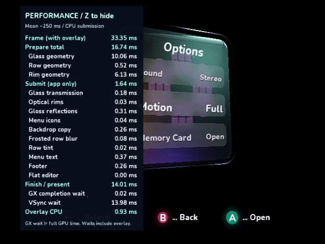

# Further native submission savings

These changes continue the [previous indexed icons/shared glass/blur work](../submission-round-2/README.md).
All timings below come from real GameCube DOLs in cloud Dolphin 2503 / Mesa
llvmpipe. They are guest-clock comparisons, not physical GameCube measurements.
Each run uses 30 warmup and 96 recorded frames with the full Z overlay enabled.
**Native VSync remains enabled.** Actual frame time is reported separately;
`active_us` only subtracts the measured retrace wait for analysis. No wait was
removed from execution.

| Increment | Frame ms | Prepare ms | App submit ms | Overlay CPU ms | Work excluding retrace ms |
|---|---:|---:|---:|---:|---:|
| 00-control | 16.681 | 7.090 | 1.800 | 1.082 | 10.034 |
| 01-glyphs | 16.681 | 7.090 | 1.675 | 0.913 | 9.740 |
| 02-tints | 16.681 | 7.091 | 1.253 | 0.913 | 9.318 |

The control reruns the exact previous optimized DOL, SHA-256
`1c6f3a18114ed73afae80ec1f6810ee301557b0804f224f7dda5e48f43936d15`.
It reproduces the previous timing means. Every result directory contains the
full frame CSV, overlay sub-scope CSV and result JSON with its DOL hash.

1. **Ordered glyph batches.** The previous path called the validated renderer
   once per glyph and recalculated each glyph's rotation. The new path fills
   fixed chunks of 16 XYUV quads, retaining glyph order, atlas sampling,
   proportional advances, rotation, stretch and smooth selected-text scaling.
   It invokes the existing packed-quad API once per chunk. App submission falls
   0.126 ms; overlay CPU falls 0.168 ms (number layout/submission 0.778 to 0.610 ms).
   Formatting and overlay final flush are essentially unchanged. The arrays are
   allocated once; the total extra staging is small enough for the 256 KiB heap.
2. **Reuse the blur mask for row tint.** The original tint path reprojected and
   submitted 108 triangles after the exact same rounded mask had already been
   uploaded for blur. A color view now shares that mesh's geometry and indices.
   Its 1296-byte RGBA stream changes only when row count or selection changes.
   Normal and selected colors come from the same constants as the fallback.
   App submission falls another 0.422 ms, including the old deferred tint flush
   previously charged to the following text scope. Preparation is unchanged;
   this is not moving the measured work into another phase.

Combined app submission falls **1.800 to 1.253 ms (30.4%)**. Total work excluding
retrace falls **10.034 to 9.318 ms**, including the separate overlay saving.
GPU draw and triangle counts remain 111 and 15,486: there is no reduction in
blur samples, rendered geometry, font quality or antialiasing policy. The
actual frontal frame remains **16.681 ms** because it still waits for refresh.

## Native captures

All figures are unscaled captures of the paused native Dolphin window. The
comparison masks only the overlay rectangle x=40..282, y=12..453. Both frontal
increments are pixel-identical everywhere outside that rectangle. Covered
pixels are not included in this claim.




The oblique pose changes as follows:

| Pose | Frame ms | Prepare ms | App submit ms | Overlay CPU ms | Work excluding retrace ms |
|---|---:|---:|---:|---:|---:|
| Previous optimized angle | 33.364 | 16.741 | 2.201 | 1.109 | 20.113 |
| Glyph batches + shared tint | 33.364 | 16.741 | 1.641 | 0.935 | 19.380 |

The angled comparison changes 16 uncovered text-edge pixels, each by at most one
8-bit color value (1/255), consistent with floating-point glyph interpolation
rounding. Visible glass, rims and panel boundaries do not change. These are not
pixel-identical angled images. The current renderer also retains its existing
visual differences from the exact mockup; no perfect visual match is claimed.
`comparisons.json` records the counts, channel bound and image hashes.



## Reproduce

The older public package pin does not contain the packed-quad or color-view APIs,
so these two paths are explicit source-SDK switches. Default published-package
builds retain their fallback. No NuGet package was overwritten or repinned.

```sh
python3 ci/build_videomode_source_sdk.py --sdk /path/to/DolphinDotNet \
  --hypercube /path/to/hypercube-engine --output /tmp/videomode \
  --icons --glass --blur --glyphs --tints
```

Omit `--glyphs` and `--tints` for the previous path, add only `--glyphs` for its
isolated increment, or add `--scene Oblique` for the angled comparison. Add
`--normal` for the interactive executable. All buffer uploads and resource
creation occur between frames. The Y/BBA log schema is unchanged.

## Remaining opportunities

In the optimized oblique screenshot, text is roughly 0.37 ms, the footer 0.26 ms
and backdrop capture 0.26 ms. Reusing prepared text layout and caching immutable
footer index commands in the SDK are plausible next experiments. No saving is
claimed for those unimplemented experiments. Live capture depends on moving
content and requires a real copy; skipping it without a content-change check
would freeze the frost. Geometry preparation at 16.741 ms remains the larger
limit on the angled frame. Reducing submission alone has not made it a 60 Hz
scene. The GX wait metric is not total GPU execution time.

## Native controls and validation

The normal all-feature source build was replayed through the real Dolphin
controller path. [Z held/toggle](interactive/02-z-held-visible.png),
[A opens the editor](interactive/04-editor-visible.png),
[B returns](interactive/06-reopened-options.png),
[16:9 keep with the overlay hidden](interactive/08-widescreen-hidden.png), and
[X restores 480 interlaced / 4:3](interactive/09-safe-mode.png) are captured.
These unscaled window captures use the fixed 640x480 presentation window; the
16:9 output is anamorphic there. Event logs and the normal DOL hash are retained.

Calendar covers the two-row mesh padding and changing selected tint:
[two frosted rows](calendar/01-calendar-two-rows.png),
[separate hour/minute edits to 13:01](calendar/02-time-parts.png),
[month edited to 02](calendar/03-date-parts.png), and
[B cancels both edits](calendar/04-calendar-cancelled.png). The calendar figures
are byte-for-byte native Dolphin frame dumps at 640x528, without resizing. Their
hashes and source frame filenames are recorded. Both time and date revert to
12:00 and 01/01/2026, and the selected Date row receives the correct tint.

Menu/scan regression tests, managed and normal native published-package builds,
all-feature source-SDK review and normal native builds, manifest/run/test
validators and `git diff --check` passed. Native runs exercise long text chunks,
selected-text growth, multiple menu faces, resize/revert and no per-frame resource
creation on the new paths. Source SDK #155 and Hypercube #9 CI are green; Samples
CI reruns separately for this follow-up. No PR has been merged by this task.
