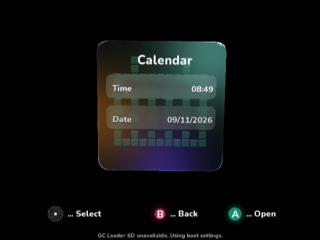
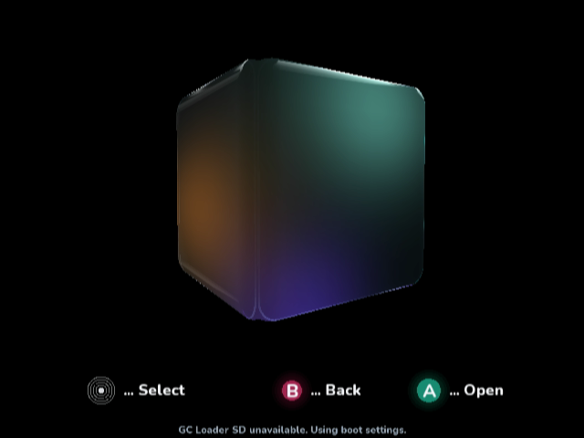

# Attach the outer polish to the rounded cube

The marked Calendar strip combined the rounded surface's bevel reflection with
an outer polish contour that was larger than the surface itself. The former
inset optical wall is already absent. The remaining polish still used a
near-unit rectangle and a lateral refraction offset, leaving a detached border.

The polish now follows a cross-section of the same rounded box as the glass:
`radius = sqrt(Round² - (depth - Core)²) + 0.003`. Its corner centers share the
solid's `Core` coordinate. This removes the lateral offset and keeps only a small
clearance from the glass. Three narrow polish bands remain; no inset ring is
introduced. Their depth spacing preserves a visible highlight at native resolution.
Surface reflection strength fades smoothly with grazing angle so the transition
from the flat face into the bevel does not light a separate broad inner band.

The first native iteration made the polish too thin; its unscaled captures and
DOL hash are retained in [first](first). Final native captures and build
provenance are retained alongside this document. These are real GameCube DOL
frames captured in Dolphin 2503 at completed presentation boundaries, decoded
from the original XFB with BT.601 color conversion, without resizing or scene
composition. Raw buffers remain in the task's artifacts.

Reproduce front/turning captures using `ci/review_performance_overlay.py
--rim-review --native-boundaries --sdk <source-sdk> --dol <normal-dol>
--logs <fresh-directory>` in the cloud Dolphin/Xvfb environment.

Menu tests, managed compilation, native compilation, repository validators,
Python syntax and whitespace checks were run for this change. No physical
hardware performance or visual measurements are claimed. The geometry adds no
arrays or meshes; cross-section square roots are evaluated per band, outside
the vertex loop. Input, storage and video-switching code is unchanged.

## Final native findings

The Calendar front capture removes the bright inner bevel band and closes the
floating gap. The turning capture confirms that the polish remains attached to
the curved solid. It still shows the junction between the visible glass faces;
this is not a claim that every angle matches the mockup. The outer polish is
subtler than the target image. Physical hardware visual confirmation is pending.
The first capture sequence's attempted angled input stayed on Calendar; only the
final sequence returns to the main cube before capturing an actual turn.

