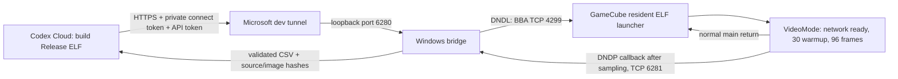

# Windows bridge for a BBA + GC Loader GameCube

This bridge lets Codex Cloud upload optimized ELF builds, collect raw native
frame timings and repeat a run without moving the GC Loader SD card. Boot the
existing DolphinDotNet resident launcher once through GC Loader/Swiss; it returns
after each benchmark. The Windows PC stays on the console's LAN.



The bridge never uses a GDB stub. The SDK's hardware GDB transport enables
`-Og` and disables normal release inlining/LTO, so those builds cannot establish
production rendering performance. The client requires Release/O3/LTO with
`DndDebugSymbols=false` and `DndGdbTransport=Off` and checks the native Makefile.
BBA/DHCP initialization completes **before** warmup. The benchmark performs no
application network or file I/O during its measured window; the initialized
native network stack remains present. Results are sent after rendering ends.

## One-time Windows setup

The host service uses Python 3.10+ and its standard library. It needs no Python
packages or .NET runtime. Microsoft `devtunnel` is needed for remote access.
Native builds happen in Codex Cloud; Git and Docker on Windows are needed only
if you rebuild the bootable launcher locally instead of using the prepared bundle.

1. Put `DolphinDotNet.Launcher.dol` in a new apps directory on GC Loader's SD and
   boot it through the existing loader menu. Its screen shows the console IP and
   upload port (4299). Keep a stable DHCP lease for that BBA address.
2. Clone/check out this branch on Windows. In PowerShell, configure that actual
   address (the address below is only an example):

   ```powershell
   ./tools/gamecube_bridge/Setup-Windows.ps1 -ConsoleAddress 192.168.1.80
   ```

   Configuration, API credentials and results live under
   `%LOCALAPPDATA%\DolphinDotNet\HardwareBridge`. The directory ACL permits the
   current user and SYSTEM. Setup does not print a credential or overwrite an
   existing configuration. Python chooses the Windows LAN address using the
   route to the configured console.
3. Permit the callback on the **private LAN** from that console only. Run setup
   with `-ConfigureFirewall` from an elevated PowerShell on initial setup, or add
   this equivalent rule separately:

   ```powershell
   New-NetFirewallRule -Name DolphinDotNet-HardwareBridge-Callback `
     -DisplayName 'DolphinDotNet GameCube telemetry' -Direction Inbound `
     -Action Allow -Protocol TCP -LocalPort 6281 -RemoteAddress 192.168.1.80 `
     -Profile Private
   ```

   The HTTP API binds only to 127.0.0.1. Do not publish the console's unauthenticated
   launcher port or the LAN callback through the tunnel.
4. Install/sign in to Microsoft's dev tunnel CLI and create a **private** tunnel
   with one HTTP port, 6280. The CLI commands are:

   ```powershell
   winget install Microsoft.devtunnel
   devtunnel user login
   devtunnel create dnd-gamecube
   devtunnel port create dnd-gamecube -p 6280 --protocol http
   ./tools/gamecube_bridge/Export-TunnelToken.ps1 -TunnelId dnd-gamecube
   ./tools/gamecube_bridge/Start-Windows.ps1 -TunnelId dnd-gamecube
   ```

   Use the actual tunnel ID returned by the CLI if it differs. See Microsoft's
   [CLI reference](https://learn.microsoft.com/azure/developer/dev-tunnels/cli-commands)
   for account/organization policy and CLI-version differences. No anonymous
   access grant is needed. `Export-TunnelToken.ps1` captures a connect-scoped JWT
   directly into the protected `tunnel-connect-token.txt`, without printing it.
   `Start-Windows.ps1` keeps the bridge and tunnel running together; Ctrl+C stops
   the owned bridge process. Standard output/error logs stay in the config folder.

To build the pinned launcher yourself, run `Build-Launcher.ps1`. It fetches the
reviewed debugger revision `6ea774fdf377324e587ee19b48ebc426207bb001`, builds it
with the pinned SDK toolchain image and includes its GPL license and complete
corresponding source archive. The same receiver is bundled with the existing
Rider/Visual Studio debugger. This Python client independently implements its
[documented DNDL v1 protocol](https://github.com/capz/DolphinDotNet.Debuggers/blob/6ea774fdf377324e587ee19b48ebc426207bb001/docs/console-launcher.md).

## Connect Codex Cloud

Provide the **nonsecret** HTTPS URL printed by `devtunnel host`. Add these as
secret bindings to the selected cloud environment (do not paste values into chat):

| Cloud variable | Windows protected file |
|---|---|
| `DND_BRIDGE_API_TOKEN` | `api-token.txt` |
| `DND_TUNNEL_ACCESS_TOKEN` | `tunnel-connect-token.txt` |

The current cloud HTTP policy is restricted; allow the exact assigned
`*.devtunnels.ms` hostname in that environment's network configuration. TLS
verification stays enabled. The client supplies `X-Tunnel-Authorization: tunnel …`
for the relay and a separate `Authorization: Bearer …` for the bridge. It refuses
credentialed redirects instead of forwarding credentials to an OAuth/other host.

Then run, with a ready receiver on the console:

```sh
python3 tools/gamecube_bridge/client.py \
  --bridge https://YOUR-ASSIGNED-TUNNEL-6280.REGION.devtunnels.ms \
  --output /workspace/artifacts/hardware/pass-01 \
  --label pass-01 --scene Options --video 480i
```

For a matched before/after comparison, run the same command first with
`--baseline-renderer --label baseline` and a fresh output directory. That option
requires a clean committed source tree and creates a separate, retained
`baseline-source` worktree under the output directory. It keeps the current
reporting/network code and SDK while restoring only `IplRenderer.cs` and
`GameCubeCanvas.cs` from measured pre-optimization checkpoint `0178139`. It never
overwrites the working branch. The resulting source digest and exact ELF hash
identify this comparison build. Then run the optimized command without the flag.

`--scene` accepts `Options`, `Oblique`, `Cube`, `Detail`; `--video` accepts 480i/p
and 576i/p. Progressive still requires the console's actual cable/display
capability. The normal interactive DOL retains A/B, video preview/rollback and Y
logging; `IplHardwareRunner=true` is an explicit, deterministic benchmark build.

Each request prepares a single-use job, compiles its callback endpoint/nonce into
an optimized native build, binds the exact ELF hash to that job, negotiates a fresh
DNDL session, verifies the receiver's image-size/CRC acknowledgement, and commits
execution once. The console renders 30 warmup plus 96 sampled frames, sends a
64-byte DNDP header and bounded 6528-byte payload, awaits a persisted-result ACK,
then returns to the resident receiver. The host waits for receiver readiness
before marking the job complete. Status polling touches Windows job state only.

Upload/execute requests are never automatically replayed. A failed/unknown
handoff requires checking the console. Only one job can own it; unrelated readiness
probes are rejected while measuring. Process restarts retain logs, mark interrupted
jobs failed and never replay them. A valid timing log is retained even if the
receiver does not become ready for the next run. The resident loader reserves the
top 2 MiB of MEM1; compare builds with that same environment.

## Evidence and limits

Every job saves `frames.csv`, a JSON summary (mean/median/p95/max), exact ELF SHA,
source revision and source-tree digest, requested and native mode/scene, callback
payload hash and receiver-return status. Native scan/face/editor fields must match
the job before the callback is accepted. CRC32 detects corruption; the private
HTTP API and per-job 128-bit callback token provide job ownership on a trusted LAN.
No hardware screenshot or physical verification is inferred from successful mocks.

Host tests exercise authentication, state ownership, compression and legacy
uploads, bad acknowledgements, checksum/schema failures, redirects and a complete
simulated upload/callback/return sequence. A real optimized GameCube DOL has also
rendered and sent 96 native samples via **Dolphin's emulated BBA**; that establishes
the native packet encoder/async sender, not physical BBA or GC Loader acceptance.
Physical upload, timing, resident return, Windows firewall and Microsoft-account
activation remain to be verified on the user's rig. Initial network startup was
observed causing a multi-second outlier; initialization now precedes warmup and
the retained retest has no such hitch. All samples, including outliers, are logged.

The first live session should run baseline and optimized builds in the same scene
and video mode, followed by oblique and flat-editor runs and 480p/576p. Use those
physical logs to decide whether the remaining rim CPU work or GPU blur work
merits the next change. Emulated frame times are not console performance claims.

```sh
python3 -m unittest discover -s tools/gamecube_bridge/tests -v
```

The `GameCube hardware bridge validation` workflow runs host tests on Windows and
Linux, parses/provisions the Windows config in an isolated runner directory, and
AOT-compiles release callback scene/mode variants without contacting hardware.
